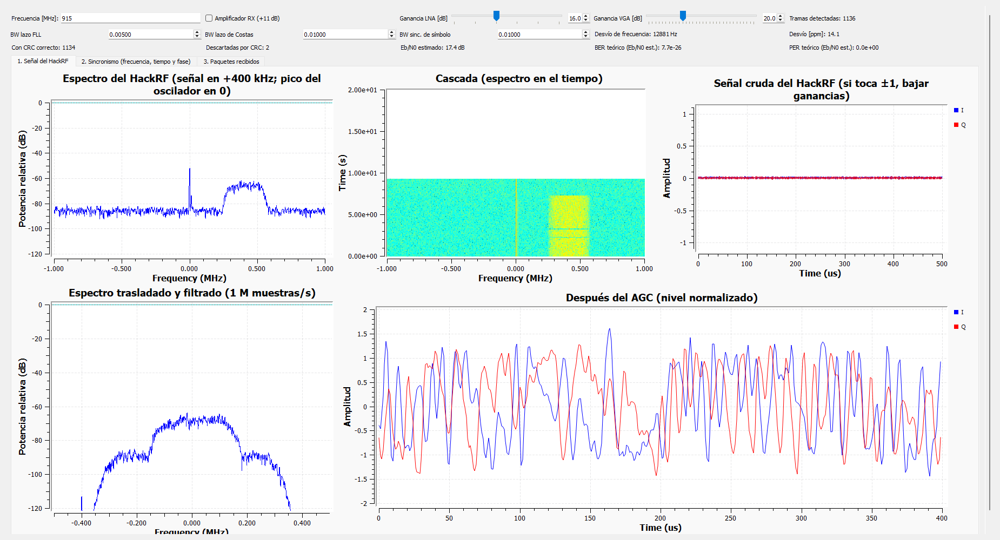
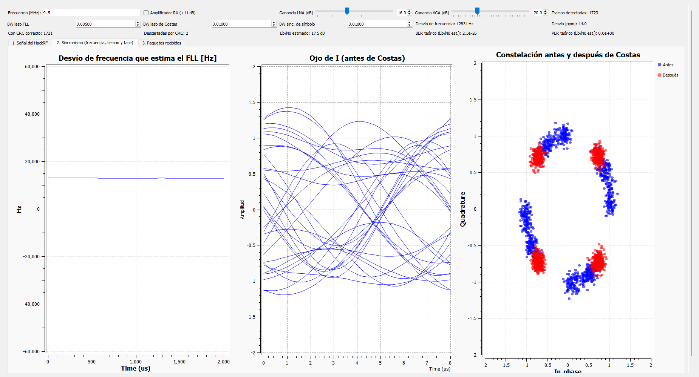

# Guía paso a paso: de la HackRF simulada a las HackRF reales

Sistemas de Comunicaciones Digitales – FACET – UNT

Cómo ensayar la prueba de laboratorio en casa y cómo hacerla después con las placas

---

Esta guía tiene dos partes:

* **Parte A, en tu PC y sin placas:** se ensaya todo con la **HackRF simulada**. Un programa hace de las dos
  placas y del aire.
* **Parte B, en el laboratorio:** lo mismo, pero con las **dos HackRF One reales**.

Las dos partes son casi iguales: cambian los archivos que se abren y, en la simulada, hay un programa más corriendo
(el emulador). Si la Parte A sale bien, la Parte B es repetir los mismos pasos.

## La idea en 30 segundos

Se manda un archivo de un HackRF (el **transmisor**, TX) a otro (el **receptor**, RX). El archivo viaja en
**paquetes numerados**, y se manda varias veces (**pasadas**): si un paquete se pierde en una pasada, llega en otra.
Al final, un programa arma el archivo recibido y comprueba que sea **idéntico** al original.

| | Parte A: HackRF simulada | Parte B: HackRF reales |
|---|---|---|
| Programa extra | `emulador_hackrf.py`, corriendo en un *radioconda Prompt* | Ninguno |
| Receptor (abrir primero) | `hackrf_simulada/hackrf_rx_archivo_sim.grc` | `grc_hackrf/hackrf_rx_archivo.grc` |
| Transmisor | `hackrf_simulada/hackrf_tx_archivo_sim.grc` | `grc_hackrf/hackrf_tx_archivo.grc` |
| Armar el archivo recibido | `python reconstruir_archivo.py hackrf_simulada\paquetes_recibidos.bin` | `python reconstruir_archivo.py` |
| Dónde queda el archivo recibido | `hackrf_simulada\recibido_<nombre>` | `grc_hackrf\recibido_<nombre>` |
| Desvío de frecuencia que se ve | +12,8 kHz (lo pone el emulador) | Unos pocos kHz, como mucho ~40 kHz |

## Antes de empezar: tres cosas básicas

**1. El radioconda Prompt.** Es una consola que ya tiene GNU Radio listo. Se abre desde el menú Inicio de Windows,
buscando "radioconda Prompt". Todos los comandos de esta guía se escriben ahí, **desde la carpeta del proyecto**.
Para ir a esa carpeta (cambiar la ruta si el proyecto está en otro lugar):

```
cd /d "D:\Facultad\Sist_Com_Dig\Proyecto_integrador\claude\integrado\files\proyecto_sdr_4qam_halfduplex\proyecto_sdr_4qam_halfduplex"
```

**2. GNU Radio Companion (GRC).** Es el programa donde se abren los `.grc`. Se abre escribiendo
`gnuradio-companion` en el prompt, o desde el menú Inicio. En GRC:

* **Abrir** un `.grc`: menú *File → Open*.
* **Ejecutar**: tecla **F6** (o el botón ▶). Se abre una ventana con gráficos.
* **Detener**: cerrar esa ventana con la **X**. Si se colgó, usar el botón *Kill* (tecla F7).

**3. El orden siempre es el mismo:** primero el **receptor** y después el **transmisor**. Así el receptor ya está
escuchando cuando empieza la transmisión.

# PARTE A: ensayo con la HackRF simulada (en tu PC)

## A1. Prueba automática (menos de un minuto)

Sirve para comprobar que todo funciona en tu PC antes de hacer nada a mano. En el prompt:

```
python hackrf_simulada\prueba_completa.py
```

La computadora hace sola 9 ensayos: transmite archivos, cambia ganancias y frecuencias y revisa los resultados.

**Tiene que aparecer:** una línea `OK` por cada caso y, al final, `9 casos, 0 fallas`.

Si aparece `FALLA`, debajo dice qué pasó. Si dice `El emulador no arrancó` y `No se pudieron abrir los puertos`,
es porque ya hay un emulador abierto de antes: cerrarlo con Ctrl+C y repetir.

## A2. Ensayo a mano (como se hará en el laboratorio)

### Paso 1: arrancar el emulador

En el prompt:

```
python hackrf_simulada\emulador_hackrf.py
```

**Tiene que aparecer:** `Emulador de dos HackRF One listo (Ctrl+C para cortar)`.

Dejar esa ventana abierta todo el ensayo. **No hacer clic adentro:** si se selecciona texto, Windows pausa el
programa. Si pasa, apretar **Esc**.

### Paso 2: encender el receptor

En GRC, abrir `hackrf_simulada/hackrf_rx_archivo_sim.grc` y apretar **F6**.

**Tiene que pasar:**

* Se abre la ventana **"[SIMULADA] HackRF RX: recepción de un archivo…"**.
* En el emulador aparece cada 2 s una línea `RX: 914.600 MHz (LNA 16 dB, VGA 20 dB, ...)`. Que diga 914,6 y no 915
  es normal: la placa se sintoniza 400 kHz más abajo.

### Paso 3: encender el transmisor

En GRC, abrir `hackrf_simulada/hackrf_tx_archivo_sim.grc` y apretar **F6**. Por defecto manda el archivo de
ejemplo `grc_hackrf/archivo_a_enviar.txt` 3 veces.

**Tiene que pasar:**

* Se abre la ventana del transmisor. Arriba muestra el nombre del archivo, los paquetes por pasada y
  "Pasadas enviadas", que sube hasta 3.
* En el emulador aparecen `>> se conectó el TX` y `TX: transmite en 914.600 MHz, -37.0 dBm`.

### Paso 4: revisar que se recibe bien

En la ventana del **receptor**, marcar cada punto:

* ☐ **Pestaña 1 (Señal del HackRF):** a la derecha de una rayita fina en el centro aparece una "montaña": es la
  señal, en +400 kHz. La rayita del centro es normal (es el oscilador de la placa).
* ☐ **Pestaña 2 (Sincronismo):** la línea de "Desvío de frecuencia que estima el FLL" está quieta, cerca de
  12 800 Hz. En la constelación, los puntos rojos ("Después") forman **4 nubes**.
* ☐ **Indicadores de arriba:** "Con CRC correcto" sube y "Descartadas por CRC" queda en 0 o casi 0.
* ☐ **Pestaña 3 (Paquetes recibidos):** filas de puntos del 0 al 11, sin huecos. Un hueco es un paquete perdido.
* ☐ **Comparar con el emulador:** el emulador dice `desvío +12.8 kHz` y el receptor muestra "Desvío de frecuencia"
  ≈ 12 800 Hz. El emulador dice `Es/N0 ~ 20.4 dB` y el receptor, "Eb/N0 estimado" ≈ 17,4 dB (Eb/N0 es 3 dB menos
  que Es/N0).



*Figura 1 – Pestaña 1 del receptor simulado: la rayita del centro y la señal ("montaña") en +400 kHz.*



*Figura 2 – Pestaña 2: desvío estimado quieto en ~12,8 kHz y constelación con 4 nubes rojas después de Costas.*

### Paso 5: terminar

Cuando "Pasadas enviadas" llegue a 3, esperar un segundo y cerrar con la **X** la ventana del transmisor y
después la del receptor.

En el emulador, apretar **Ctrl+C** para cortarlo.

### Paso 6: armar el archivo recibido

En el mismo prompt:

```
python reconstruir_archivo.py hackrf_simulada\paquetes_recibidos.bin
```

**Tiene que aparecer:** `Huella SHA-256 IGUAL a la del transmisor: el archivo llegó idéntico.`

El archivo recibido queda en `hackrf_simulada\recibido_archivo_a_enviar.txt`: abrirlo y comprobar que es el texto
original.

**Si llegaste hasta acá, el ensayo salió bien.**

## A3. Practicar (opcional, 10 minutos)

Con todo corriendo (pasos 1 a 3), probar estos cambios en las ventanas y mirar qué dice el emulador. Para que el
transmisor no termine enseguida, poner `repeticiones` en **0** (sin fin); ver la sección A4 para cambiar un parámetro.

| Qué cambiar | Qué tiene que pasar | Qué se aprende |
|---|---|---|
| Receptor: "Ganancia VGA" de 20 a 36 | El emulador pasa de `-36 dBFS` a `-20 dBFS` y el Es/N0 sube de ~20 a ~24 dB | Con poca ganancia la señal queda muy chica para el conversor de 8 bits |
| Receptor: LNA 40, VGA 50 y "Amplificador RX" | El emulador dice `SATURA`; en la pestaña 1, "Señal cruda" toca ±1 | Demasiada ganancia satura: hay que bajarla |
| Receptor: frecuencia 917 y Enter | El emulador dice `la señal NO llega`; no llegan paquetes | TX y RX tienen que estar en la misma frecuencia |
| Transmisor: "Amplitud digital" en 0,7 | El emulador dice `el DAC del TX recorta` | En el laboratorio, dejarla en 0,6 o menos |

Después de cada prueba, volver los controles a su valor original. Los 9 ejercicios completos están en
`hackrf_simulada/LEEME.md`.

## A4. Mandar tu propio archivo (práctica para el laboratorio)

1. Copiar el archivo a la carpeta `grc_hackrf/` del proyecto. Conviene uno de menos de 200 kB: un texto o una
   foto chica.
2. En GRC, en el transmisor simulado, hacer doble clic en el bloque **archivo** (arriba a la izquierda, es un
   *Parameter*).
3. En *Value* escribir `../grc_hackrf/` y el nombre, por ejemplo `../grc_hackrf/foto.jpg`. Usar barras
   `/`, no `\`. En el mismo lugar, el bloque **repeticiones** dice cuántas pasadas se mandan.
4. Repetir los pasos 1 a 6. El archivo recibido queda en `hackrf_simulada\recibido_foto.jpg`.

# PARTE B: prueba con las HackRF One reales (en el laboratorio)

## B1. Qué llevar

* ☐ Las 2 HackRF One con sus cables USB.
* ☐ 2 antenas para 915 MHz, o un cable SMA con un **atenuador de 30 dB o más**.
* ☐ La PC (o las 2 PC) con RadioConda y **una copia de la carpeta del proyecto** (por ejemplo, en un pendrive).
* ☐ El archivo que se va a mandar, ya copiado en `grc_hackrf/`.
* ☐ Esta guía impresa y la tabla de la sección B6 para anotar.

## B2. Seguridad (leer antes de enchufar)

* **Frecuencia:** usar la que autorice la cátedra. Los `.grc` usan 915 MHz por defecto.
* **Nunca unir el TX y el RX con un cable sin atenuador.** El receptor aguanta como máximo −5 dBm y el transmisor
  puede dar más de +10 dBm: se rompe.
* **Empezar con los amplificadores apagados** (casillas "Amplificador TX" y "Amplificador RX") y con las ganancias que
  vienen por defecto.
* Conectar la antena (o el cable) **antes** de transmitir, en el conector **ANTENNA**: el que está en la punta
  opuesta al USB. Los dos conectores que están junto al USB (CLKIN y CLKOUT) **no** son para la antena.

## B3. Conectar y reconocer las placas

### Paso 1: ver que la PC encuentra las placas

Ponerles una etiqueta con cinta: **A** y **B**. Enchufarlas por USB y, en el prompt (desde la carpeta del
proyecto):

```
hackrf_info
```

**Tiene que aparecer:** cada placa con `HackRF One`, su número de serie (*Serial number*) y la versión de firmware.

Si dice `No HackRF boards found`, probar otro cable u otro puerto USB.

### Paso 2: decirle a cada `.grc` qué placa usar (solo si las dos están en la misma PC)

Si cada placa está en una PC distinta, saltear este paso.

Con las dos en la misma PC:

1. En el prompt, correr `SoapySDRUtil --find="driver=hackrf"` y anotar el `serial = ...` de cada placa. Para saber
   cuál es cuál, desenchufar una y volver a correrlo.
2. En GRC, abrir `grc_hackrf/hackrf_tx_archivo.grc`, hacer doble clic en la variable **dispositivo** y escribir el
   serial de la placa A entre comillas, así: `"serial=0000000000000000a06063c8234e5f5f"` (con el número real).
   Guardar con Ctrl+S.
3. Hacer lo mismo en `grc_hackrf/hackrf_rx_archivo.grc` con el serial de la placa B.

### Paso 3: probar cada placa sola, escuchando radio FM

1. Abrir `grc_hackrf/hackrf_rx_archivo.grc` y apretar F6. Se prende la luz **RX** de la placa.
2. En "Frecuencia [MHz]" escribir **98** y apretar Enter.
3. **Tiene que pasar:** en el espectro y en la cascada de la pestaña 1 se ven varias montañas: son las radios FM
   de la zona. La placa recibe bien.
4. Volver a escribir **915** y apretar Enter. Cerrar la ventana.

Si las dos placas están en la misma PC, repetirlo con la otra placa: cambiar momentáneamente el serial de
`dispositivo` del receptor.

## B4. Prueba 1: mandar el archivo de A a B

Son los mismos pasos de la Parte A, con estas diferencias: **no hay emulador** y se abren los `.grc` de la carpeta
`grc_hackrf/`.

### Paso 1: encender el receptor (placa B)

Abrir `grc_hackrf/hackrf_rx_archivo.grc` y apretar **F6**. En la pestaña 1 se ve el ruido y la rayita del centro.
Es normal.

### Paso 2: encender el transmisor (placa A)

1. Abrir `grc_hackrf/hackrf_tx_archivo.grc`.
2. Doble clic en el bloque **archivo**: escribir el nombre del archivo, por ejemplo `foto.jpg` (está en la misma
   carpeta `grc_hackrf/`). En **repeticiones**, dejar 3.
3. Apretar **F6**. Se prende la luz **TX** de la placa A.

### Paso 3: ajustar las ganancias

Mirar la pestaña 1 del **receptor**:

* La "montaña" de la señal tiene que estar **20 a 40 dB por encima del ruido**.
* En "Señal cruda del HackRF", la señal tiene que quedar **lejos de ±1** (como mucho, alrededor de 0,5).

**Si la señal es débil**, subir en este orden, de a poco: "Ganancia VGA" del RX → "Ganancia LNA" del RX →
"Ganancia TX (VGA)" del transmisor. Los amplificadores, solo si no alcanza, y **nunca** con cable sin atenuador.

**Si la señal cruda toca ±1** (saturación), bajar las mismas ganancias en el orden inverso.

En el transmisor, la "Amplitud digital" tiene que quedar en **0,6 o menos**.

### Paso 4: revisar que se recibe bien

Es la misma lista del paso 4 de la Parte A. Dos diferencias:

* El desvío de frecuencia ya no es 12,8 kHz: es el error real entre los cristales de las dos placas. Puede ser
  cualquier valor, positivo o negativo, de hasta unos 40 kHz.
* El emulador ya no está: los números se leen solo en la ventana del receptor.

**Anotar en la tabla (B6):** "Desvío de frecuencia" [Hz], "Desvío [ppm]", "Eb/N0 estimado" y las ganancias que se
usaron.

### Paso 5: terminar y armar el archivo

Cuando "Pasadas enviadas" llegue a 3, esperar un segundo y cerrar las dos ventanas con la **X**. Después, en el
prompt:

```
python reconstruir_archivo.py
```

**Tiene que aparecer:** `Huella SHA-256 IGUAL a la del transmisor: el archivo llegó idéntico.` También muestra
cuántos paquetes llegaron, cuántos se perdieron y el PER medido: anotarlos.

Abrir `grc_hackrf\recibido_<nombre>` y comprobar el archivo a simple vista (por ejemplo, que la foto se vea bien).

### Paso 6: guardar los resultados

La próxima vez que se encienda el receptor, los archivos se pisan. Guardarlos en una carpeta por prueba:

```
mkdir laboratorio\prueba_1
copy grc_hackrf\*_recibidos.bin laboratorio\prueba_1\
copy grc_hackrf\recibido_* laboratorio\prueba_1\
```

Sacar también una captura de pantalla de cada pestaña del receptor (tecla Impr Pant).

## B5. Pruebas 2 y 3

### Prueba 2: señal débil (A → B)

Repetir la prueba 1, pero **bajando la "Ganancia TX (VGA)"** del transmisor de a poco, hasta que se pierdan
algunos paquetes: aparecen huecos en la pestaña 3 y el "Eb/N0 estimado" queda entre 8 y 10 dB. Poner
**repeticiones en 5**.

**Qué se busca mostrar:**

* El PER medido (de `reconstruir_archivo.py`) es parecido al "PER teórico" que muestra el receptor.
* Aunque se pierdan paquetes, con varias pasadas el archivo igual llega idéntico.

Guardar en `laboratorio\prueba_2`.

### Prueba 3: al revés (B → A)

Cambiar los papeles: la placa B transmite y la A recibe.

* **Con dos PC:** abrir el transmisor en la PC de B y el receptor en la de A.
* **Con una PC:** intercambiar los seriales de la variable `dispositivo` en los dos `.grc`.

Repetir la prueba 1 y guardar en `laboratorio\prueba_3`. Así queda probado el enlace en los dos sentidos, uno por
vez (*half-duplex*).

Hay una prueba 4 opcional, con las dos placas usando el mismo reloj, en la sección 7 de `LABORATORIO_HACKRF.md`.

## B6. Tabla para anotar

| Prueba | Sentido | Distancia o cable | Ganancias TX (VGA / amp) | Ganancias RX (LNA / VGA / amp) | Eb/N0 estimado | Desvío [Hz] / [ppm] | Paquetes recibidos / perdidos | PER medido | PER teórico | ¿Idéntico? |
|---|---|---|---|---|---|---|---|---|---|---|
| 1. Señal buena | A → B | | | | | | | | | |
| 2. Señal débil | A → B | | | | | | | | | |
| 3. Señal buena | B → A | | | | | | | | | |

## B7. Si algo falla

| Qué pasa | Qué hacer |
|---|---|
| `hackrf_info` dice `No HackRF boards found` | Probar otro cable u otro puerto USB |
| Al apretar F6: `RuntimeError: SoapySDR::Device::make() no match` | GNU Radio no encuentra la placa. Revisar `hackrf_info`; que no la esté usando otra ventana; con dos placas en la PC, que el serial de `dispositivo` sea el correcto |
| No se ve la señal en el receptor | Misma frecuencia en TX y RX; antena en el conector ANTENNA; subir ganancias (paso 3) |
| La señal cruda toca ±1, o la constelación es una mancha | Saturación: bajar la VGA o el LNA del RX, o la VGA del TX |
| Hay "Tramas detectadas" pero muchas "Descartadas por CRC" | Señal débil o saturada: volver al paso 3 |
| El desvío pasa de ~40 kHz y no llegan paquetes | Corregir la frecuencia del receptor en esa diferencia. Por ejemplo, con +50 kHz de desvío, escribir 915.050 |
| En la consola de GRC aparecen muchas letras `U` u `O` | La PC no da abasto: cerrar otros programas, o usar una PC por placa |
| `reconstruir_archivo.py` dice que faltan paquetes | Mandar más pasadas (repeticiones) o mejorar la señal |

La lista completa está en la sección 10 de `LABORATORIO_HACKRF.md`.

## B8. Después del laboratorio

Con la tabla B6 completa, lo que mostró `reconstruir_archivo.py` en cada prueba y las capturas, se agregan los
resultados al informe (`INFORME.md` y su PDF).
