# Sistema de comunicaciones digital half-duplex con modulación 4-QAM mediante radio definida por software

**Simulación en GNU Radio y prueba de laboratorio con HackRF One**

**Autores:** Juan José Armando Gerez Jiménez

Sistemas de Comunicaciones Digitales – Facultad de Ciencias Exactas y Tecnología (FACET), Universidad Nacional de Tucumán

Noviembre de 2026

---

## Resumen

Este trabajo presenta el diseño, la simulación y la prueba real de un sistema de comunicaciones digital punto a punto
hecho con radio definida por software. El sistema es half-duplex, usa tramas con preámbulo e indicación de longitud,
detecta errores con CRC-32 y transmite con modulación 4-QAM. Se armó en GNU Radio únicamente con bloques estándar.

Se calculó el BER teórico en función de la relación señal/ruido y se midió el BER en simulación para cuatro condiciones
de canal. El BER medido sigue a la teoría a lo largo de más de cuatro décadas, con una diferencia de apenas 0,08 dB
cuando el receptor corrige la fase. De las 206 473 tramas que el CRC-32 aceptó, ninguna tenía errores.

En la prueba de laboratorio se transmitieron archivos por el aire entre dos HackRF One separados unos 40 cm, a 915 MHz.
La prueba documentada con capturas usó un archivo de texto. Fue necesario subir las ganancias del receptor hasta
LNA 40 dB y VGA 40 dB. Con esos valores, el Eb/N0 estimado fue de unos 23 dB, el receptor corrigió un desvío de frecuencia
de unos 7 kHz entre las placas y el archivo llegó idéntico, según su huella SHA-256. También llegaron idénticas una
imagen y una canción.

Se concluye que el sistema cumple los objetivos planteados. Frente al ruido se comporta como predice la teoría. Las pocas
tramas que se perdieron en el laboratorio no se explican por el ruido: en el registro de la canción coinciden con cortes
breves y periódicos. El CRC-32 impide que esos errores lleguen al archivo y la repetición del envío recupera los datos.

**Palabras clave:** radio definida por software, 4-QAM, BER, CRC-32, half-duplex, GNU Radio, HackRF One.

---

## 1. Introducción

Una radio definida por software permite armar un sistema de comunicaciones completo con una computadora y un equipo de
radio económico. El mismo sistema se puede simular, medir y después transmitir por el aire. Este proyecto sigue ese
camino con un enlace simple, para comparar en cada paso lo que predice la teoría con lo que realmente ocurre.

### 1.1 Objetivos

* Desarrollar un sistema de comunicaciones digital punto a punto con técnica de radio definida por software, con estas
  características: half-duplex, trama simple con preámbulo e indicación de longitud, detección de errores con CRC-32 y
  modulación 4-QAM.
* Determinar el BER teórico en función de la relación señal/ruido.
* Realizar una simulación en GNU Radio del sistema desarrollado.
* Medir el BER en la simulación para distintas condiciones de canal y compararlo con el resultado teórico.
* Realizar una prueba de laboratorio transmitiendo archivos con periféricos de radio definida por software HackRF.

### 1.2 Marco teórico

#### Radio definida por software

En una radio definida por software (SDR, del inglés *Software Defined Radio*), funciones que antes hacían circuitos
electrónicos, como modular, filtrar o sincronizar, las hace un programa [1]. El equipo de radio solo convierte entre la
señal de radiofrecuencia y las muestras digitales.

En este proyecto se usó GNU Radio, un entorno libre en el que un sistema se arma conectando bloques [2]. Cada diagrama de
bloques se llama *flowgraph* y se edita con GNU Radio Companion (GRC). Como equipo de radio se usó el HackRF One, que
trabaja de 1 MHz a 6 GHz, con muestras de 8 bits y entre 2 y 20 millones de muestras por segundo [3].

#### Half-duplex

Un enlace half-duplex permite comunicarse en los dos sentidos, pero no al mismo tiempo. El HackRF One es half-duplex: en
un momento dado transmite o recibe, pero no ambas cosas [3]. Una forma simple de repartir el canal es la división en el
tiempo (TDD, del inglés *Time Division Duplex*), en la que cada nodo transmite solo en su turno.

#### Modulación 4-QAM y filtro RRC

La modulación 4-QAM envía 2 bits en cada símbolo, usando dos componentes de la señal: I (en fase) y Q (en cuadratura). Los
cuatro símbolos tienen la misma amplitud y solo cambia su fase, por lo que 4-QAM es equivalente a QPSK (Figura 1, a la
izquierda). Con el mapeo Gray, dos símbolos vecinos difieren en un solo bit. Así, el error más común, que es confundir un
símbolo con su vecino, arruina un solo bit [4].

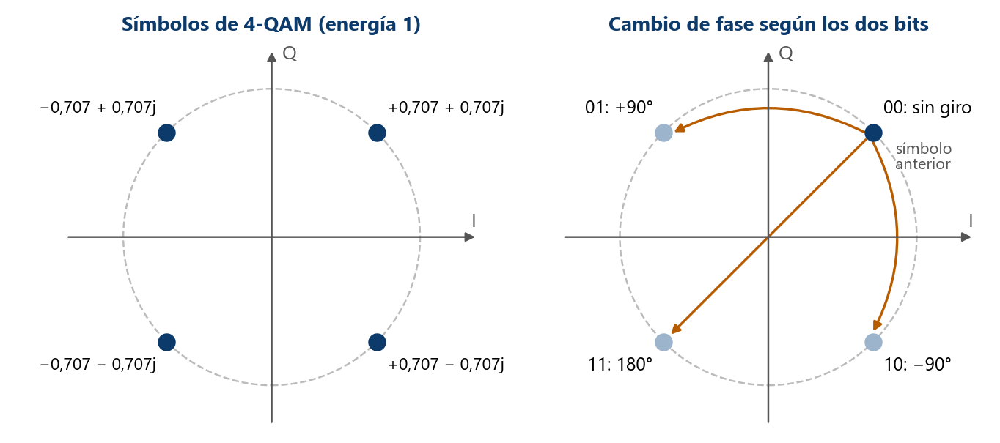

*Figura 1 – A la izquierda, los cuatro símbolos de 4-QAM. A la derecha, la codificación diferencial que usa este sistema:
cada par de bits indica cuánto gira la fase respecto del símbolo anterior. Los giros de ±90° corresponden a pares que
difieren en un bit de "00", y el de 180° a un par que difiere en dos bits.*

Para no ocupar más ancho de banda del necesario, cada símbolo se envía con un pulso de raíz de coseno alzado (RRC). El
receptor usa un filtro igual, llamado filtro adaptado. Los dos juntos evitan que un símbolo interfiera con sus vecinos en
el instante en que se toma la decisión [4], [5]. El ancho de banda ocupado es (1 + α)·R<sub>s</sub>, donde R<sub>s</sub>
es la velocidad de símbolos y α es el factor de exceso de banda, que en este proyecto vale 0,35.

#### Canal con ruido y relación señal/ruido

El modelo de canal es el de ruido blanco gaussiano aditivo (AWGN, del inglés *Additive White Gaussian Noise*): a la señal
se le suma ruido con densidad espectral de potencia N0. La calidad del enlace se expresa con Eb/N0, la energía de cada bit
dividida por N0. Esta medida no depende del ancho de banda, por lo que permite comparar sistemas distintos. Se relaciona
con la energía por símbolo E<sub>s</sub> y con la relación señal/ruido (SNR) medida muestra a muestra de este modo:

<div class="ecuacion">Es/N0 = 2 · Eb/N0<span class="num">(1)</span></div>

<div class="ecuacion">SNR = (Es/N0) / sps<span class="num">(2)</span></div>

donde sps es la cantidad de muestras por símbolo. En la simulación sps = 4, y entonces SNR [dB] = Eb/N0 [dB] − 3,01 dB.

#### BER teórico

El BER (del inglés *Bit Error Rate*) es la fracción de bits que llegan con error. En 4-QAM, cada componente se comporta como
una señal de dos niveles con ruido gaussiano. Si el receptor conoce exactamente la fase, la probabilidad de error de bit es
[4], [5]:

<div class="ecuacion">p = Q( √(2 · Eb/N0) ),&nbsp;&nbsp; con Q(x) = ½ · erfc(x / √2)<span class="num">(3)</span></div>

En la práctica, el receptor recupera la fase a partir de la propia señal, con un lazo de Costas [6]. Este lazo no puede saber
en cuál de las cuatro rotaciones posibles se enganchó, porque todas se ven iguales. Si queda girado 90°, todos los bits salen
mal. Para evitarlo se usa la codificación diferencial: la información no va en el símbolo, sino en el cambio de fase entre
un símbolo y el siguiente (Figura 1, a la derecha). Un giro fijo afecta por igual a dos símbolos seguidos y se cancela al
compararlos.

El costo es que cada bit se obtiene comparando dos decisiones, y queda mal cuando falla exactamente una de las dos. Por eso,
el BER de este sistema es:

<div class="ecuacion">P<sub>b</sub> = 2 · p · (1 − p) ≈ 2 · p<span class="num">(4)</span></div>

Es decir, casi el doble que sin codificación diferencial. Expresada en dB, esta penalidad es pequeña, porque la curva es muy
empinada (Tabla 1). Una simulación estadística (Monte Carlo) independiente de GNU Radio, incluida en `ber_teorico.py`,
reproduce la ecuación (4) con menos de 1 % de diferencia hasta 6 dB. A 8 dB la diferencia es de 4,5 %, que se explica por
la poca cantidad de errores que ocurren a ese nivel en esa simulación.

*Tabla 1 – Eb/N0 necesario para cada valor de BER.*

| BER buscado | 10⁻² | 10⁻³ | 10⁻⁴ | 10⁻⁵ | 10⁻⁶ |
|---|---:|---:|---:|---:|---:|
| Sin codificación diferencial, ecuación (3) [dB] | 4,32 | 6,79 | 8,40 | 9,59 | 10,53 |
| Con codificación diferencial, ecuación (4) [dB] | 5,20 | 7,33 | 8,79 | 9,89 | 10,78 |
| Penalidad [dB] | 0,88 | 0,55 | 0,39 | 0,30 | 0,25 |

#### Error de fase sin corregir

Si el receptor no corrige una rotación fija φ de la señal, los dos ejes dejan de tener el mismo margen frente al ruido. Cada
uno tiene su propia probabilidad de error:

<div class="ecuacion">p<sub>a</sub> = Q( √(2 · Eb/N0) · (cos φ − sen φ) ),&nbsp;&nbsp; p<sub>c</sub> = Q( √(2 · Eb/N0) · (cos φ + sen φ) )<span class="num">(5)</span></div>

Para φ = 20°, cos φ − sen φ ≈ 0,60, lo que significa que el margen de un eje se reduce un 40 %. Con codificación diferencial,
el BER se obtiene combinando p<sub>a</sub> y p<sub>c</sub> sobre dos decisiones seguidas (función `ber_deqpsk_phase_error` de
`ber_teorico.py`). La Figura 2 reúne las curvas teóricas.

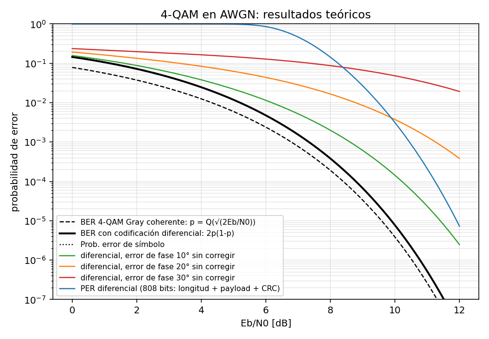

*Figura 2 – Curvas teóricas de 4-QAM en AWGN. La línea negra gruesa es la ecuación (4), la que corresponde a este sistema, y
la línea de trazos es la ecuación (3). Las líneas verde, naranja y roja muestran cuánto empeora el BER con un error de fase
fijo sin corregir. La línea azul es el PER de una trama de la simulación.*

#### Trama, CRC-32 y PER

Una trama simple tiene tres partes. El preámbulo es un patrón fijo de bits que el receptor busca para encontrar el comienzo.
La indicación de longitud dice cuántos bytes siguen. El CRC-32 es un código de 32 bits calculado a partir de los datos: el
receptor lo vuelve a calcular y, si no coincide, descarta la trama. Detecta todos los errores de hasta 3 bits y cualquier
ráfaga de hasta 32 bits; de los demás patrones de error deja pasar, aproximadamente, 1 de cada 4300 millones (2⁻³²) [7].

El PER (del inglés *Packet Error Rate*) es la fracción de tramas que no llegan bien. Una trama de n bits llega bien solo si no
hay ningún error de decisión en ella:

<div class="ecuacion">PER = 1 − (1 − p)<sup>n</sup><span class="num">(6)</span></div>

Se usa p y no el BER de la ecuación (4) porque, con codificación diferencial, cada error de decisión arruina dos bits seguidos
de la misma trama: con el BER, cada error se contaría dos veces. En la simulación, n vale unos 810 bits (longitud, datos y
CRC-32); en el indicador del laboratorio, 1744 bits (la trama completa de 218 bytes).

#### Sincronización en un receptor real

Además de decidir los símbolos, un receptor real tiene que resolver tres problemas:

* **Frecuencia.** Los osciladores de dos equipos nunca son iguales, y su diferencia se llama desvío de frecuencia. Una
  corrección gruesa se logra con un lazo FLL de borde de banda, que compara la energía en los dos bordes del espectro RRC y
  ajusta la frecuencia hasta igualarlas [8].
* **Tiempo.** Hay que tomar cada símbolo en el instante justo. De eso se encarga el bloque `Symbol Sync`, que mide el error de
  temporización y corrige el punto de muestreo [9].
* **Fase.** El lazo de Costas corrige la fase y el pequeño desvío de frecuencia que quede [6].

El ancho de banda de cada lazo define un compromiso: un lazo ancho se engancha rápido pero deja pasar más ruido, y uno angosto
es más estable pero más lento.

El receptor del laboratorio también estima la relación señal/ruido con el método de los momentos de segundo y cuarto orden
(M2M4), que no necesita conocer los datos transmitidos [10]. Para comprobar que un archivo llegó completo se usa la huella
SHA-256, un resumen de 256 bits de su contenido: si cambia un solo bit del archivo, la huella resulta completamente distinta
[11].

### 1.3 Antecedentes

Se buscaron trabajos previos que combinen GNU Radio con equipos SDR para transmitir datos digitales. Los más cercanos a este
proyecto son los siguientes:

* **Transmisión por paquetes con QPSK.** Kaliaskarov y otros [12] combinan análisis teórico, simulación en GNU Radio y pruebas
  por el aire con placas ADALM-PLUTO. Miden BER, PER y velocidad efectiva, reconstruyen archivos y atribuyen las diferencias
  con la teoría a errores de sincronismo, desbalance entre I y Q y ruido de fase. Es el antecedente más parecido en su
  planteo.
* **BER medido contra la teoría.** El banco de pruebas COSMOS publica un tutorial que mide el BER contra Eb/N0 para BPSK, QPSK
  y 8PSK, con dos radios USRP B210 y GNU Radio 3.10, y lo compara con las curvas teóricas [13].
* **Comunicación por paquetes en GNU Radio.** El tutorial oficial [14] muestra cómo armar un transmisor y un receptor de
  paquetes con bloques estándar como `Stream CRC32`, `Protocol Formatter` y `Correlate Access Code - Tag Stream`. Se tomó como
  referencia para usar esos bloques.
* **HackRF y GNU Radio en la enseñanza.** Del Barrio y otros [15] proponen esta combinación para enseñar teoría de las
  comunicaciones, y la evalúan en una prueba con 36 estudiantes.
* **Transmisión de archivos con HackRF One.** Castillo Alarcón y otros [16] implementan un modulador GMSK con HackRF One y GNU
  Radio y lo demuestran enviando un archivo de texto. El repositorio abierto HackRF-data [17] también transfiere datos binarios
  entre dos HackRF One.
* **Trabajos finales de carrera.** Tábara Carbajo [18] simula modulaciones en GNU Radio y luego transmite con HackRF hacia un
  receptor RTL-SDR. Sáenz Valero [19] implementa modulaciones PSK y QAM con herramientas de código abierto.

A partir de estos antecedentes, este proyecto reúne en un solo sistema, armado solo con bloques estándar: trama con CRC-32,
turnos half-duplex en simulación, comparación del BER con una teoría que incluye la codificación diferencial, y transmisión
real de archivos entre dos HackRF One, verificada con SHA-256.

---

## 2. Metodología

El trabajo se hizo por etapas, y cada etapa se comprobó antes de pasar a la siguiente:

1. **Cálculo teórico.** Se obtuvieron las fórmulas del BER y del PER, y se verificaron con la simulación Monte Carlo.
2. **Diseño en GNU Radio.** Se armó el sistema solo con bloques estándar, para que cualquier persona pueda abrir los flowgraphs
   sin instalar nada adicional. Se hicieron tres flowgraphs: un enlace en un solo sentido con un gráfico por etapa, para
   estudiar cada bloque; el sistema half-duplex completo con interfaz; y el mismo sistema sin interfaz, para medir.
3. **Medición del BER en simulación** (sección 2.2).
4. **Adaptación a HackRF y ensayo sin equipos** (sección 2.3).
5. **Prueba de laboratorio** (sección 2.4).

### 2.1 Herramientas y repositorio

Se usó GNU Radio 3.10.12 con Python 3.11 (distribución RadioConda, en Windows) y dos HackRF One. La Tabla 2 resume el
contenido del repositorio.

*Tabla 2 – Contenido principal del repositorio.*

| Archivo o carpeta | Contenido |
|---|---|
| `grc_estandar/` | Los tres flowgraphs de la simulación |
| `grc_hackrf/` | Transmisor y receptor para HackRF One |
| `ber_teorico.py` | Fórmulas del BER y del PER, y verificación Monte Carlo |
| `run_ber_sweep.py` | Barrido automático de BER en todas las condiciones de canal |
| `reconstruir_archivo.py` | Arma el archivo recibido y verifica su huella SHA-256 |
| `tests/`, `hackrf_simulada/` | Pruebas automáticas y emulador de los HackRF |
| `resultados/`, `resultados_laboratorio/` | Mediciones, gráficos y capturas de pantalla |

### 2.2 Medición del BER en simulación

Se usó la versión sin interfaz del sistema, ejecutada por `run_ber_sweep.py`. El método fue el siguiente:

* **Barrido.** Eb/N0 de 0 a 10 dB, de a 1 dB, en cuatro condiciones de canal: (1) AWGN; (2) AWGN con rotación de fase de 20° sin
  corregir, con el lazo de Costas desactivado; (3) AWGN con 20° y lazo de Costas; (4) AWGN con 20°, desvío de frecuencia de
  200 Hz y lazo de Costas.
* **Cantidad de datos.** En cada punto se acumularon alrededor de 400 errores, con un mínimo de 4×10⁶ y un máximo de 2×10⁸
  muestras, y se sumaron los resultados de los dos nodos. En total fueron 44 puntos, 5,4×10⁸ muestras y 2,3×10⁸ bits
  comparados.
* **Comparación de bits.** Un detector marca el final del primer preámbulo. Desde allí, los bits recibidos se comparan uno a uno
  con una copia del transmisor del otro nodo, usando el bloque estándar `BER`.
* **Arranque.** Se descartan los primeros 100 000 bits, porque mientras los lazos se enganchan hay una ráfaga de errores que no
  representa el funcionamiento normal.
* **Cálculos.** BER = errores / bits comparados, con intervalo de confianza de Wilson al 95 % [20].
  PER = 1 − (tramas con CRC correcto / tramas enviadas).

Todas las condiciones usan la misma semilla de ruido. Entre dos ejecuciones completas del barrido, la cantidad de errores puede
variar levemente (hasta 0,04 %), sin que cambien las conclusiones.

Durante el desarrollo, varias decisiones de diseño surgieron de comparar las mediciones con la teoría (Tabla 3).

*Tabla 3 – Problemas detectados al comparar con la teoría, y cómo se resolvieron.*

| Problema observado | Causa | Solución |
|---|---|---|
| El BER daba 0 con Eb/N0 alto | El bloque `Channel Model` reutiliza solo 16 384 valores de ruido | Canal armado con `Noise Source` y `Add` |
| BER 1,7 veces mayor que la teoría a 6 dB | Lazos de Costas y de sincronismo demasiado anchos | Anchos de banda 0,005 y 0,01: la relación bajó a 1,06 |
| Tramas perdidas por el enganche del lazo de Costas | El lazo puede quedar girado 90° | Codificación diferencial y teoría de la ecuación (4) |
| BER 1,5 a 2 veces mayor con desvío de frecuencia | Aplicar el desvío en el canal compartido genera saltos de fase en cada turno | Desvío aplicado a la entrada de cada receptor |
| Con desvío, BER 2 a 3 veces mayor en corridas cortas | Ráfaga de errores mientras se engancha el lazo | Descartar los primeros 100 000 bits |

### 2.3 Preparación de la prueba de laboratorio

Antes de usar las placas se hicieron dos ensayos sin equipos, ambos con los flowgraphs de la prueba real:

* **Canal de laboratorio simulado** (`tests/test_hackrf.py`, 7 pruebas). Reemplaza los HackRF por un canal con desvío de hasta
  ±40 kHz, relojes distintos en ±20 ppm, ruido de fase y ruido previo al comienzo de la transmisión. Con este canal se eligieron
  los anchos de banda de los lazos: con FLL 0,005 y Costas 0,01 el PER fue de 0,06 a 0,09 a Eb/N0 = 9 dB (teórico: 0,058),
  mientras que con FLL 0,02 y Costas 0,02 subía a 0,4.
* **Emulador de los dos HackRF** (`hackrf_simulada/`, 9 casos). Un programa en Python imita las placas y el aire, para ensayar el
  procedimiento completo en una sola computadora, incluyendo errores como la saturación o una frecuencia mal elegida.

Estas pruebas se volvieron a ejecutar con los flowgraphs usados en el laboratorio y todas dieron resultado correcto, al igual que
las 9 pruebas de la simulación (`tests/test_flowgraphs.py`).

### 2.4 Prueba de laboratorio

Las dos placas se conectaron por USB a una misma computadora y se ubicaron a unos 40 cm de distancia, cada una con su antena
(Figura 3). Se trabajó a 915 MHz, dentro de la banda ISM de 902 a 928 MHz de la Región 2 [21], con los amplificadores apagados.

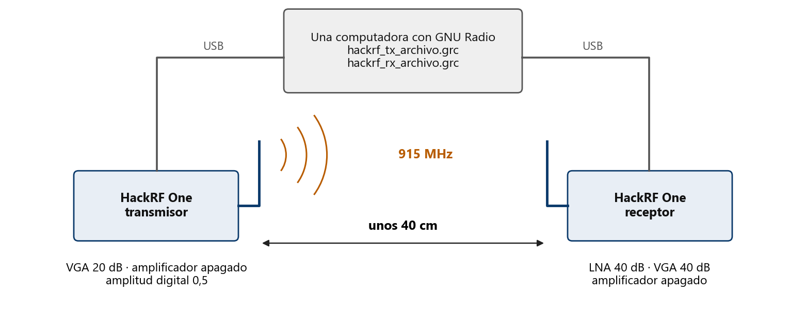

*Figura 3 – Disposición de los equipos en la prueba de laboratorio, con los ajustes finales.*

El procedimiento fue el siguiente:

1. Se asoció cada flowgraph a su placa mediante el número de serie y se eligió el archivo a enviar.
2. Con los dos flowgraphs en marcha, se ajustaron las ganancias del receptor mirando el espectro y la señal cruda. Se buscó que
   la señal quedara bien por encima del ruido y lejos del límite de ±1, donde el conversor del HackRF satura.
3. Se comprobó el sincronismo en la constelación y se observaron los indicadores: tramas detectadas, tramas con CRC correcto,
   Eb/N0 estimado y desvío de frecuencia.
4. Se dejó transmitir el archivo durante varias pasadas y se guardaron capturas de pantalla.
5. Se cerraron los flowgraphs y se ejecutó `reconstruir_archivo.py`, que ordena los paquetes por número, descarta los repetidos,
   arma el archivo y compara su huella SHA-256 con la del transmisor.

En el laboratorio, el receptor no tiene una copia de los datos con la cual comparar mientras recibe, así que el BER no se midió de
forma directa. La prueba se evaluó con las tramas descartadas y con la igualdad exacta entre el archivo enviado y el recibido.

---

## 3. Resultados y discusión

### 3.1 Diseño obtenido

#### Formato de trama

La Figura 4 muestra el formato de la trama. El preámbulo es el código de acceso estándar de GNU Radio, y el receptor lo acepta
aunque tenga hasta 12 bits erróneos de 64. La longitud se envía dos veces, y la trama solo se acepta si las dos copias coinciden.
El CRC-32 es el mismo que usa Ethernet: se comprobó que el bloque `Stream CRC32` da el mismo resultado que la función estándar
`zlib.crc32`.

En el laboratorio, los datos llevan delante un número de 2 bytes. Al conjunto de número y datos se lo llama *paquete*. El archivo
se envía por *pasadas*: un relleno al azar, que da tiempo a que los lazos del receptor se enganchen, seguido de todos los paquetes.
El último paquete describe el archivo con su nombre, su tamaño y su huella SHA-256.

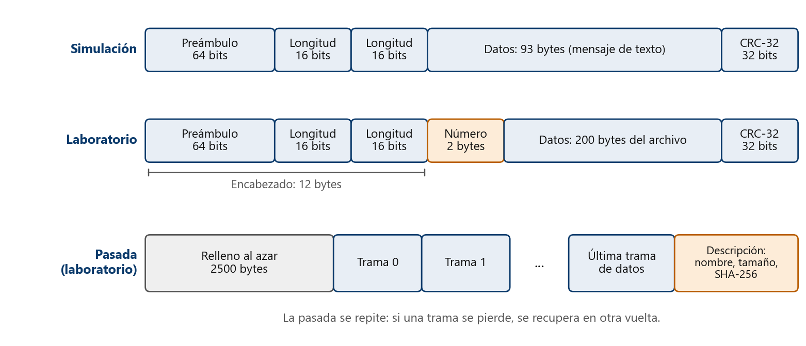

*Figura 4 – Formato de la trama en simulación y en laboratorio, y estructura de una pasada. En naranja, lo que se agrega para el
laboratorio.*

#### Transmisor y receptor

La Figura 5 muestra las etapas del sistema, y las Figuras 6 y 7 los flowgraphs reales del laboratorio. En el transmisor, `Stream
CRC32` agrega el CRC-32, `Protocol Formatter` arma el encabezado y `Tagged Stream Mux` lo une a los datos. `Constellation Modulator`
agrupa los bits de a dos, aplica la codificación diferencial y el filtro RRC.

En el receptor, el filtro adaptado, `Symbol Sync` y `Costas Loop` recuperan los símbolos. `Constellation Decoder`, `Differential
Decoder` y `Map` los convierten en bits. `Correlate Access Code - Tag Stream` busca el preámbulo, lee la longitud y entrega los datos
de la trama. Por último, `Stream CRC32` verifica el código y deja pasar solo las tramas correctas. La Tabla 4 resume los parámetros principales.

*Tabla 4 – Parámetros principales.*

| Parámetro | Simulación | Laboratorio |
|---|---|---|
| Frecuencia de muestreo | 500 kHz | 2 MHz (1 MHz en el receptor, después de filtrar) |
| Muestras por símbolo | 4 | 8 en el transmisor, 4 en el receptor |
| Velocidad de símbolos | 125 000 símbolos/s | 250 000 símbolos/s |
| Velocidad de bits en el canal | 250 kbit/s | 500 kbit/s |
| Factor de exceso de banda | 0,35 | 0,35 |
| Ancho de banda ocupado | 169 kHz | 338 kHz |
| Datos por trama | 93 bytes | 202 bytes (número y datos) |
| Trama completa | 109 bytes | 218 bytes |
| Ancho de banda de los lazos | Costas 0,005; sincronismo 0,01 | FLL 0,005; Costas 0,01; sincronismo 0,01 |

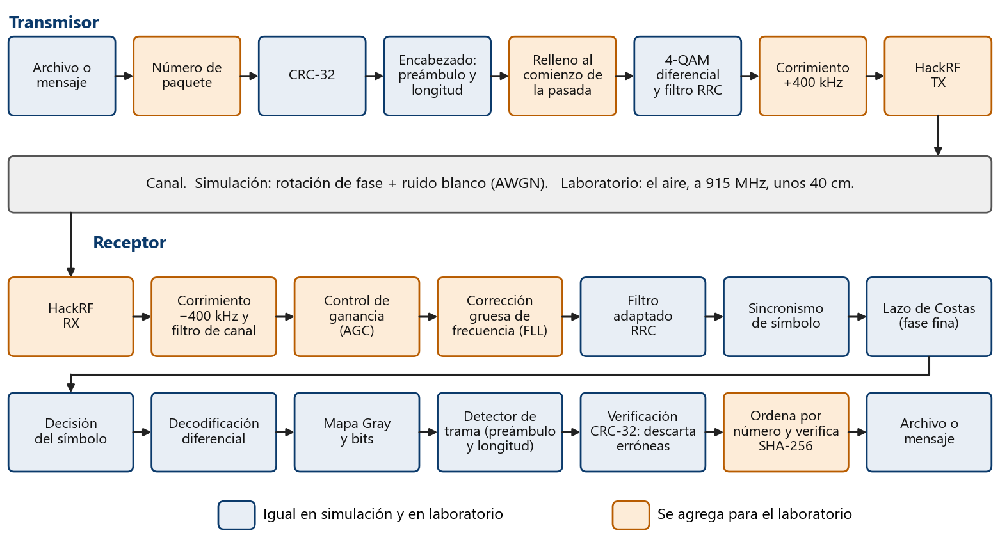

*Figura 5 – Etapas del transmisor y del receptor. El receptor de la simulación y el del laboratorio usan los mismos bloques a partir
del filtro adaptado.*

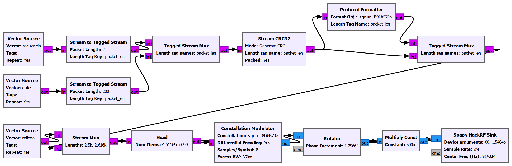

*Figura 6 – Flowgraph del transmisor (`hackrf_tx_archivo.grc`), dibujado por GNU Radio Companion. Para que se pueda leer en la hoja,
los bloques se acercaron y se omitieron los comentarios, las variables y los gráficos. La salida de arriba a la derecha vuelve a la
entrada `in1` del `Stream Mux`, que alterna el relleno con las tramas.*

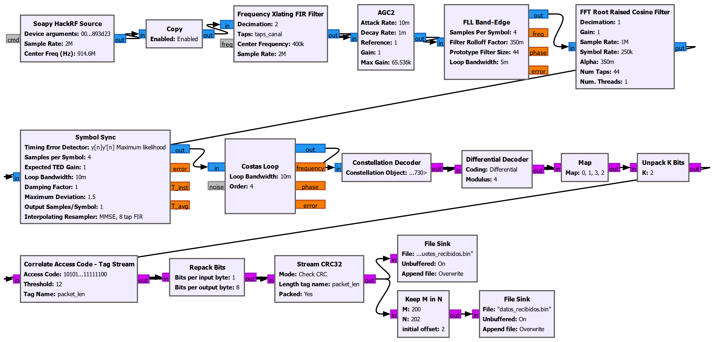

*Figura 7 – Flowgraph del receptor (`hackrf_rx_archivo.grc`), con el mismo criterio. También se omitieron los gráficos, las sondas de
los indicadores y los bloques que arman el gráfico de números de paquete. La cadena sigue de una fila a la siguiente.*

#### Canal simulado

El canal se armó con bloques simples, para que la calibración quede a la vista: `Multiply Const` aplica la rotación de fase, y
`Noise Source` con `Add` suman el ruido. Como la señal tiene potencia 1 por muestra, el desvío estándar del ruido se calcula con:

<div class="ecuacion">σ = √( sps / (2 · Eb/N0) )<span class="num">(7)</span></div>

#### Half-duplex por división en el tiempo

La Figura 8 muestra cómo los dos nodos comparten el canal, y la Figura 9 el flowgraph correspondiente. `Stream Mux` toma, en forma
cíclica, 2048 muestras del nodo A, 256 de silencio, 2048 del nodo B y otras 256 de silencio. A 500 kHz, eso equivale a turnos de
4,1 ms separados por 0,5 ms. `Stream Demux` usa el mismo patrón y envía cada turno al receptor que corresponde. Cada nodo ocupa el
44 % del tiempo, es decir, unos 111 kbit/s por sentido.

El desvío de frecuencia se aplica a la entrada de cada receptor, con signo opuesto en cada uno (+Δf en B, −Δf en A), porque es la
diferencia entre los osciladores de los dos nodos y no una propiedad del canal.

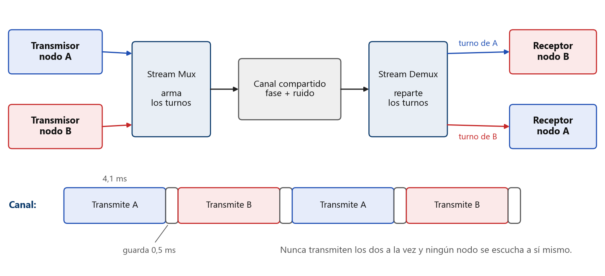

*Figura 8 – Sistema half-duplex de la simulación y reparto del canal en el tiempo.*

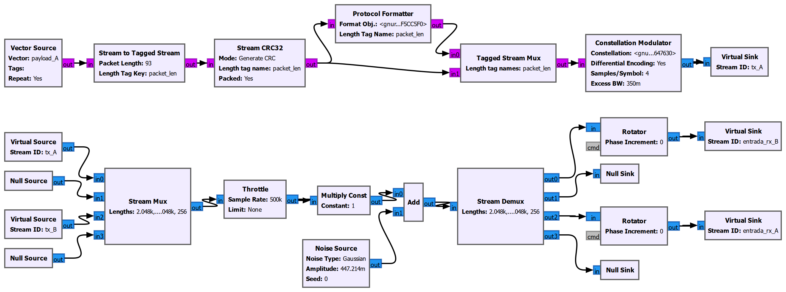

*Figura 9 – Parte de `halfduplex_4qam.grc`. Arriba, el transmisor del nodo A (el del nodo B es igual). Abajo, los turnos, el canal
y el reparto hacia cada receptor. Se omitieron los gráficos y los comentarios.*

#### Adaptación a los HackRF

*Tabla 5 – Qué se agregó para trabajar con equipos reales.*

| Problema del equipo real | Solución |
|---|---|
| El receptor no sabe a qué parte del archivo corresponde cada trama, ni si se perdió alguna | Número de paquete de 2 bytes y paquete final de descripción |
| Al comenzar, los lazos del receptor tardan en engancharse | Relleno de 2500 bytes al inicio de cada pasada |
| El HackRF tiene una espiga justo en la frecuencia sintonizada | Corrimiento digital de 400 kHz: las placas se sintonizan a 914,6 MHz y la señal va en +400 kHz, por lo que la espiga queda fuera del filtro |
| El HackRF necesita al menos 2 millones de muestras por segundo | Transmisor con 8 muestras por símbolo. El receptor baja a 1 millón de muestras por segundo, y recupera las 4 muestras por símbolo de la simulación |
| El nivel recibido depende de la distancia y las ganancias | Control automático de ganancia (`AGC2`) |
| Los osciladores de las placas difieren en varios kHz | Corrección gruesa de frecuencia (`FLL Band-Edge`), preparada para desvíos de hasta unos ±40 kHz |
| No hay canal de vuelta para pedir lo que se perdió | El archivo se repite y `reconstruir_archivo.py` toma cada paquete de la pasada en que llegó bien |

### 3.2 Resultados de la simulación

#### Funcionamiento del sistema half-duplex

Las Figuras 10 y 11 muestran la interfaz con Eb/N0 = 8 dB, una rotación de fase de 20° y un desvío de 200 Hz.

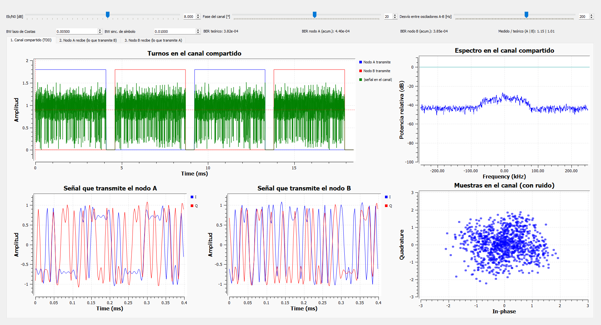

*Figura 10 – `halfduplex_4qam.grc`, pestaña 1. Arriba a la izquierda se ven los turnos: el nodo A (azul) y el nodo B (rojo) se
alternan, y la señal del canal (verde) solo aparece en el turno de cada uno. En las guardas, el canal queda en silencio.*

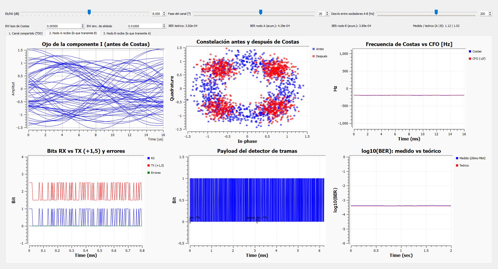

*Figura 11 – Pestaña 2: el nodo A recibe lo que transmite B. Antes del lazo de Costas, la constelación (azul) es un anillo, porque la
fase gira; después (rojo) quedan cuatro nubes. El lazo estima −200 Hz, que es el desvío que ve el nodo A. Abajo: los bits recibidos
coinciden con los transmitidos en la ventana mostrada, y el BER medido queda sobre el teórico.*

#### BER en canal AWGN

*Tabla 6 – BER y PER medidos en canal AWGN, comparados con la teoría.*

| Eb/N0 [dB] | Bits comparados | Errores | BER medido | Intervalo de confianza (95 %) | BER teórico | Medido / teórico | PER medido | PER teórico |
|---:|---:|---:|---:|---:|---:|---:|---:|---:|
| 0 | 1 576 600 | 235 556 | 1,49×10⁻¹ | [1,49 ; 1,50]×10⁻¹ | 1,45×10⁻¹ | 1,03 | 1,000 | 1,000 |
| 1 | 1 576 600 | 172 870 | 1,10×10⁻¹ | [1,09 ; 1,10]×10⁻¹ | 1,06×10⁻¹ | 1,03 | 1,000 | 1,000 |
| 2 | 1 577 472 | 118 010 | 7,48×10⁻² | [7,44 ; 7,52]×10⁻² | 7,22×10⁻² | 1,04 | 1,000 | 1,000 |
| 3 | 1 577 472 | 73 760 | 4,68×10⁻² | [4,64 ; 4,71]×10⁻² | 4,47×10⁻² | 1,05 | 1,000 | 1,000 |
| 4 | 1 577 472 | 40 674 | 2,58×10⁻² | [2,55 ; 2,60]×10⁻² | 2,47×10⁻² | 1,04 | 1,000 | 1,000 |
| 5 | 1 577 472 | 19 506 | 1,24×10⁻² | [1,22 ; 1,25]×10⁻² | 1,18×10⁻² | 1,04 | 0,994 | 0,992 |
| 6 | 1 577 472 | 7 836 | 4,97×10⁻³ | [4,86 ; 5,08]×10⁻³ | 4,77×10⁻³ | 1,04 | 0,864 | 0,856 |
| 7 | 1 577 472 | 2 588 | 1,64×10⁻³ | [1,58 ; 1,70]×10⁻³ | 1,54×10⁻³ | 1,06 | 0,493 | 0,465 |
| 8 | 1 577 472 | 584 | 3,70×10⁻⁴ | [3,41 ; 4,01]×10⁻⁴ | 3,82×10⁻⁴ | 0,97 | 0,147 | 0,143 |
| 9 | 5 747 531 | 428 | 7,45×10⁻⁵ | [6,77 ; 8,19]×10⁻⁵ | 6,73×10⁻⁵ | 1,11 | 0,030 | 0,027 |
| 10 | 51 451 402 | 508 | 9,87×10⁻⁶ | [9,05 ; 10,8]×10⁻⁶ | 7,74×10⁻⁶ | 1,27 | 0,004 | 0,003 |

El BER medido sigue a la ecuación (4) desde 1,5×10⁻¹ hasta 1×10⁻⁵, es decir, a lo largo de más de cuatro décadas (Figura 12). Entre 0 y 7 dB
resulta entre 3 % y 6 % mayor que la teoría. Esa diferencia es real, porque con tantos errores contados el intervalo de confianza es muy chico.
Equivale a solo 0,08 dB y se llama pérdida de implementación: el lazo de Costas y el sincronismo de símbolo estiman la fase y el instante
de muestreo a partir de una señal con ruido, y esas estimaciones tienen su propio error. A 9 y 10 dB la relación sube a 1,11 y 1,27. Esto
no indica un problema mayor: como allí la curva es muy empinada, el mismo corrimiento pequeño en dB produce una relación más grande.

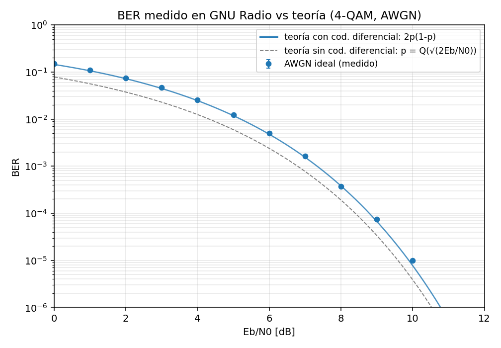

*Figura 12 – BER medido (puntos, con su intervalo de confianza) y teoría con codificación diferencial (línea azul). La línea gris es la
teoría sin codificación diferencial.*

#### Otras condiciones de canal

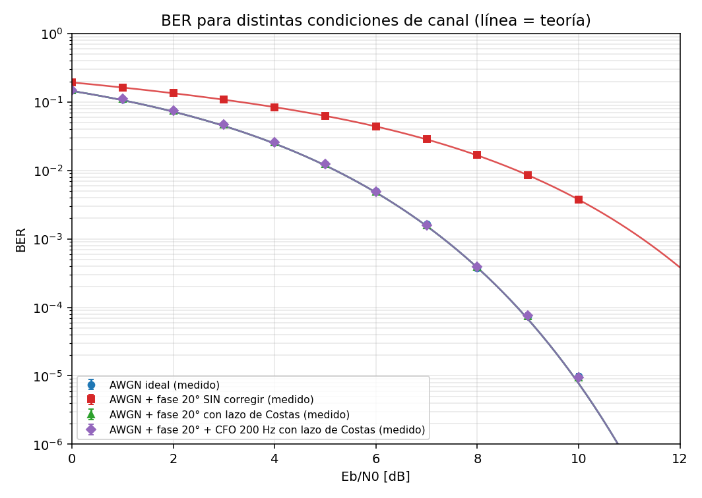

*Figura 13 – BER en las cuatro condiciones de canal (puntos: medido; línea: teoría de cada caso). Las tres condiciones con corrección de
fase quedan una sobre otra, sobre la curva teórica.*

*Tabla 7 – Pérdida respecto de la teoría, entre 2 y 10 dB. La pérdida es cuántos dB más necesitaría la curva teórica para dar el BER
medido.*

| Condición de canal | Pérdida [dB] | Medido / teórico (promedio) |
|---|---:|---:|
| AWGN | +0,08 | 1,04 |
| AWGN + fase de 20° sin corregir (referida a su propia teoría) | +0,02 | 1,01 |
| AWGN + fase de 20° con lazo de Costas | +0,08 | 1,04 |
| AWGN + fase de 20° + desvío de 200 Hz con lazo de Costas | +0,08 | 1,04 |

Estos resultados significan lo siguiente:

* **Sin corregir la fase**, el sistema es mucho peor: a 10 dB, el BER es de 3,72×10⁻³, contra 7,74×10⁻⁶ en el caso ideal, casi tres décadas
  de diferencia. Pero el valor coincide con la teoría de la sección 1.2, lo que valida ese modelo.
* **Con el lazo de Costas**, la misma rotación queda compensada y se recupera la curva ideal.
* **Con un desvío de 200 Hz**, la fase gira unos 250° a lo largo de cada trama, de modo que sin seguimiento la trama sería irrecuperable.
  El lazo de Costas estima el desvío (Figura 11) y el BER es el mismo que sin desvío.

#### Tramas y CRC-32

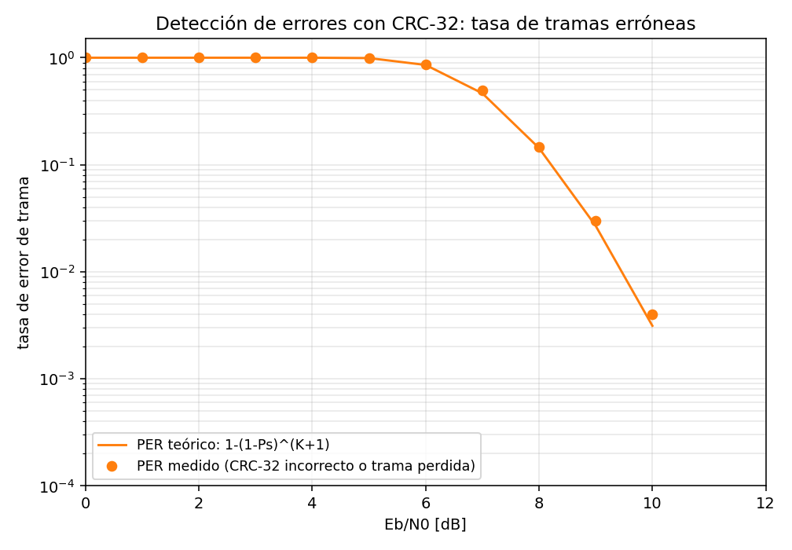

*Figura 14 – PER medido en canal AWGN (puntos) y PER teórico (línea).*

El PER medido también coincide con la teoría, por ejemplo 0,147 contra 0,143 a 8 dB, y 0,030 contra 0,027 a 9 dB. En todo el barrido se
enviaron 275 647 tramas y el receptor aceptó 206 473. Cada una se comparó con el mensaje transmitido y **ninguna** tenía contenido distinto.
Este resultado es coherente con la probabilidad de 2⁻³² de que el CRC-32 deje pasar una trama errónea.

En conjunto, la simulación muestra que el sistema armado con bloques estándar se comporta como predice la teoría, con una pérdida de
implementación menor a 0,1 dB, y que el CRC-32 impide entregar datos con errores.

### 3.3 Resultados de la prueba de laboratorio

#### Condiciones de la prueba

*Tabla 8 – Condiciones de la prueba con el archivo de texto.*

| Parámetro | Valor |
|---|---|
| Frecuencia | 915 MHz (placas sintonizadas a 914,6 MHz) |
| Distancia entre placas | Unos 40 cm, por el aire |
| Computadoras | Una sola, con las dos placas conectadas |
| Transmisor | VGA 20 dB, amplificador apagado, amplitud digital 0,5 |
| Receptor | LNA 40 dB, VGA 40 dB, amplificador apagado |
| Anchos de banda de los lazos | FLL 0,005; Costas 0,01; sincronismo de símbolo 0,01 |
| Archivo | `archivo_a_enviar.txt`: 2125 bytes, 12 paquetes por pasada, 0,08 s cada pasada |
| Huella SHA-256 | Comienza con 44e310390b75b43a |

#### Ajuste de las ganancias

Con las ganancias iniciales del receptor (LNA 16 dB y VGA 20 dB, 36 dB en total) los datos no se recibían bien, y desde el primer momento
hubo que subirlas hasta LNA 40 dB y VGA 40 dB (80 dB en total). No hizo falta encender los amplificadores ni aumentar la potencia de
transmisión.

Las capturas permiten estimar el motivo. Con 80 dB de ganancia, la señal cruda llega a ±0,3 (Figura 16). Son 44 dB más que al comienzo, es
decir, 158 veces en amplitud. Por lo tanto, con los valores iniciales la señal habría llegado a unos ±0,002. Un escalón del conversor de
8 bits del HackRF equivale a 1/128 ≈ 0,008, así que la señal quedaba por debajo de un solo escalón.

La señal es débil a propósito: se transmite con poca ganancia para no interferir, y en 40 cm a 915 MHz se pierden además unos 24 dB en el
aire (valor de espacio libre, solo orientativo a tan poca distancia). El emulador usado en los ensayos previos, en cambio, recibía bien con
las ganancias iniciales. La enseñanza práctica es que los niveles absolutos no se pueden predecir bien de antemano y hay que ajustarlos en
el lugar, mirando la señal cruda.

#### Lo que muestran las capturas

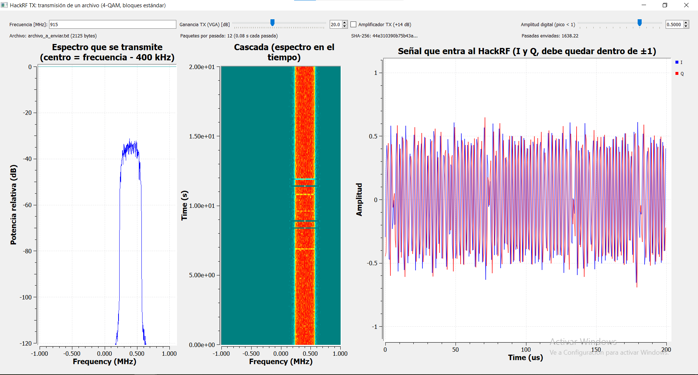

*Figura 15 – Transmisor, prueba real. El espectro corresponde a la señal digital antes de entrar al HackRF: está centrada en +400 kHz y ocupa
unos 340 kHz, como se esperaba. I y Q quedan dentro de ±1, con picos cercanos a 0,7. Arriba se leen el archivo, los 12 paquetes por pasada,
la huella SHA-256 y las 1638 pasadas enviadas hasta el momento de la captura.*

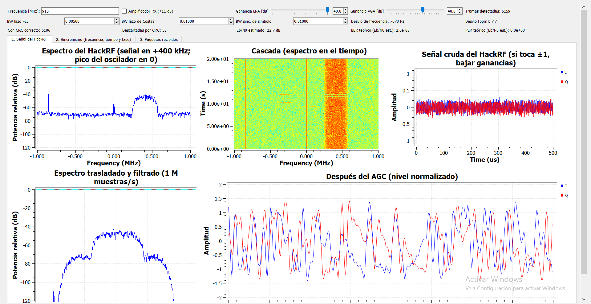

*Figura 16 – Receptor, pestaña 1, prueba real. La señal aparece en +400 kHz, unos 30 dB por encima del ruido. La espiga en 0 es propia del
HackRF, y por eso la señal se corrió 400 kHz. La señal cruda llega a ±0,3, lejos de saturar. Abajo, la señal ya centrada y filtrada, y la
salida del control de ganancia, con el nivel normalizado.*

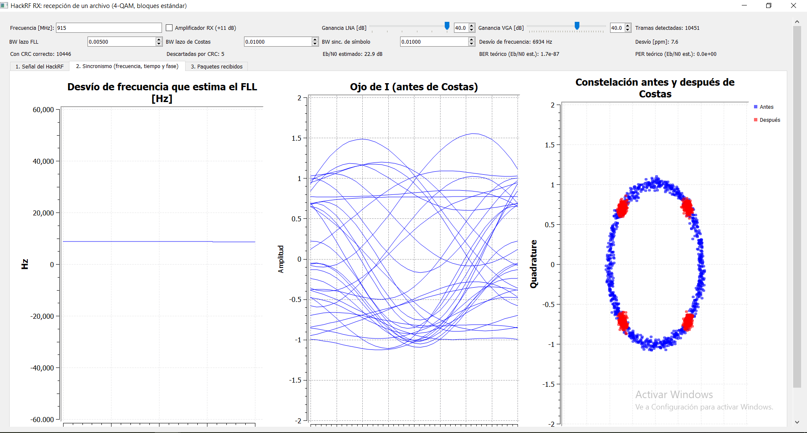

*Figura 17 – Receptor, pestaña 2, prueba real. El FLL se mantiene estable en unos 9 kHz. El ojo de la componente I se ve cerrado porque se mide
antes del lazo de Costas, cuando la fase todavía gira. En la constelación, "Antes" es un anillo y "Después" son cuatro nubes compactas. El
anillo se ve ovalado solo porque los ejes tienen distinta escala.*

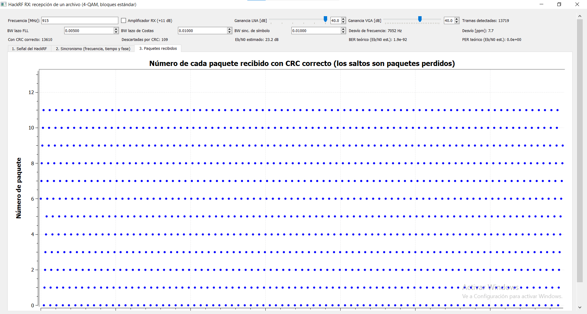

*Figura 18 – Receptor, pestaña 3, prueba real. Cada fila de puntos es un número de paquete, del 0 al 11. Las 12 filas están completas: en la
ventana que muestra el gráfico no falta ningún paquete.*

Las capturas permiten observar lo siguiente:

* **La señal transmitida es la esperada.** Su posición y su ancho coinciden con el diseño (Figura 15) y se reconocen en el receptor (Figura 16).
* **El sincronismo funciona con un desvío real.** La constelación pasa de un anillo a cuatro nubes (Figura 17). El FLL corrige unos 9 kHz y el
  lazo de Costas, unos −2 kHz. La suma, unos 7 kHz, es el desvío real entre las placas.
* **Las líneas horizontales de las cascadas no son fallas.** Corresponden a los bytes en cero que completan el último paquete de datos y el de
  descripción: 169 de los 5116 bytes de cada pasada (3,3 %). Con codificación diferencial, una serie de ceros repite el mismo símbolo, y por un
  instante la señal es casi un tono puro. La cascada dibuja un renglón cada 0,1 s, de modo que unos 7 de cada 200 caen en esos tramos, que es
  lo que se ve en la Figura 15.
* **La espiga en −0,85 MHz** (Figura 16) es un tono angosto ajeno a la señal. No se investigó su origen; queda fuera del filtro de canal y no
  afecta la recepción.

#### Indicadores del receptor

*Tabla 9 – Valores que muestra el receptor en las tres capturas, tomadas en distintos momentos.*

| Indicador | Figura 16 | Figura 17 | Figura 18 |
|---|---:|---:|---:|
| Tramas detectadas | 6159 | 10 451 | 13 719 |
| Con CRC correcto | 6106 | 10 446 | 13 610 |
| Descartadas por CRC | 53 | 5 | 109 |
| Descartadas / detectadas | 0,86 % | 0,05 % | 0,79 % |
| Eb/N0 estimado | 22,7 dB | 22,9 dB | 23,2 dB |
| Desvío de frecuencia | 7070 Hz | 6934 Hz | 7052 Hz |
| Desvío en ppm | 7,7 | 7,6 | 7,7 |
| BER teórico para ese Eb/N0 | 2,6×10⁻⁸³ | 1,7×10⁻⁸⁷ | 1,9×10⁻⁹² |
| PER teórico para ese Eb/N0 | 0 | 0 | 0 |

Estos valores significan lo siguiente:

* **La señal estuvo muy por encima del mínimo necesario.** Según la ecuación (6), un PER de 10⁻³ en estas tramas requiere 10,7 dB, y la prueba
  se hizo con unos 23 dB. Hay un margen de unos 12 dB. Además, el valor de unos 30 dB que se ve en el espectro es del mismo orden que el
  E<sub>s</sub>/N<sub>0</sub> estimado, de unos 26 dB (Eb/N0 + 3 dB).
* **El desvío entre las placas es estable y es 35 veces mayor que el simulado.** Se mantuvo cerca de 7 kHz (7,7 ppm), muy por debajo de los
  ±40 kHz previstos. Para un desvío de este tamaño conviene la corrección gruesa del FLL, y dejar al lazo de Costas, que tiene un ancho de banda
  angosto, solo lo que quede.
* **Se descartaron menos del 1 % de las tramas, aunque la teoría da 0.** Con este Eb/N0, el ruido no puede explicar esas tramas, así que deben
  tener otra causa. Hay que tener en cuenta que este indicador es la resta de dos contadores que se leen por separado dos veces por segundo, por
  lo que sirve como referencia y no como conteo exacto. Además, acumula desde el arranque, que incluye el tiempo en que se ajustaban las
  ganancias. El conteo exacto de pérdidas requiere el registro de paquetes, y solo se conservó el de la canción.

#### Archivo recibido

Al terminar, `reconstruir_archivo.py` armó el archivo a partir de los paquetes con CRC correcto. La copia recibida coincide byte a byte con el
original. Este es el comienzo del archivo recibido:

```
Sistemas de Comunicaciones Digitales - FACET - UNT
Proyecto integrador: enlace punto a punto half-duplex con 4-QAM
Prueba de laboratorio con HackRF: transmision de un archivo

Si este texto se puede leer completo en la computadora del receptor, el archivo viajo por el aire
desde un HackRF hasta el otro y llego sin errores.
```

En la computadora del laboratorio el texto tenía finales de línea de Windows, y por eso la Figura 15 indica 2125 bytes. Las copias guardadas en el
repositorio, tanto la original como la recibida, tienen finales de línea de un solo carácter y ocupan 2089 bytes: la diferencia son las 36 líneas
del texto. Se verificó que, al agregar esos 36 caracteres a la copia del repositorio, se obtiene la misma huella que muestra la Figura 15.

#### Otros archivos transmitidos

Con el mismo sistema también se transmitieron una imagen y una canción (Tabla 10). En los tres casos, el archivo recibido es idéntico al original.

*Tabla 10 – Archivos transmitidos. La velocidad útil es el tamaño del archivo dividido por la duración de una pasada.*

| Archivo | Tamaño [bytes] | Paquetes por pasada | Duración de una pasada | Velocidad útil | Huella SHA-256 (comienzo) | Resultado |
|---|---:|---:|---:|---:|---|---|
| Texto | 2125 | 12 | 0,08 s | 208 kbit/s | 44e310390b75b43a | Idéntico |
| Imagen (JPEG) | 7992 | 41 | 0,18 s | 349 kbit/s | 27c7679bc4d6d143 | Idéntico |
| Canción (MP3) | 3 521 652 | 17 610 | 61,5 s | 458 kbit/s | 6122486beb190811 | Idéntico |

En los archivos chicos, la velocidad útil es menor porque el relleno de 40 ms ocupa una parte importante de cada pasada. En los grandes, se acerca
a 459 kbit/s (200 de cada 218 bytes, a 500 kbit/s).

De la canción se conservó el registro completo de paquetes, que permite contar con exactitud lo que los indicadores muestran solo de forma
aproximada. En 183 s de recepción, casi tres pasadas, llegaron 52 451 paquetes con CRC correcto y se perdieron 31 (PER = 5,9×10⁻⁴). Los
52 448 paquetes de datos recibidos se compararon con el original, unos 84 millones de bits, y **no hubo ni un bit distinto**. Cada paquete perdido
en una pasada llegó en otra.

Las 31 pérdidas no están repartidas al azar, sino concentradas en tres momentos (Tabla 11).

*Tabla 11 – Momentos en que se perdieron paquetes durante la recepción de la canción.*

| Tiempo desde la primera pérdida | Paquetes perdidos | Números de paquete |
|---|---|---|
| 0 s | 10 | 7678 a 7687 |
| 60,00 s | 10 | 7258 a 7267 |
| 120,00 s | 1 + 10 | 6830, y 6839 a 6848 |

Cada corte dura unos 35 ms y se repite cada 60,00 s, con una diferencia de milisegundos. Este dato descarta dos explicaciones:

* **No es ruido.** El ruido produciría pérdidas sueltas y repartidas al azar, y a este Eb/N0 prácticamente ninguna.
* **No depende del archivo.** Una pasada dura 61,46 s, así que un problema del contenido afectaría siempre a los mismos paquetes. En cambio, cada
  corte afecta a paquetes distintos.

No se determinó la causa. Por su regularidad, las explicaciones más probables son una tarea periódica de la computadora, que manejaba las dos placas
a la vez, o un equipo externo que transmita una vez por minuto en la banda ISM. Un corte así afectaría, en la prueba de texto, unas 5 a 7 de cada
8800 tramas (0,06 % a 0,08 %), del mismo orden que el 0,05 % de la Figura 17.

### 3.4 Comparación entre simulación y laboratorio

*Tabla 12 – Comparación de los resultados.*

| Aspecto | Simulación | Laboratorio |
|---|---|---|
| Canal | Ruido blanco, con fase y desvío elegidos | Aire, unos 40 cm, 915 MHz |
| Eb/N0 | De 0 a 10 dB, fijado en el programa | Unos 23 dB, estimado por el receptor |
| Desvío de frecuencia | 200 Hz | Unos 7000 Hz |
| Corrección de frecuencia | Lazo de Costas | FLL (unos 9 kHz) y lazo de Costas (unos −2 kHz) |
| BER | Medido: sigue a la teoría (+0,08 dB) | Sin medición directa; 0 bits distintos en los paquetes aceptados de la canción |
| Tramas perdidas | Coinciden con la teoría (0,147 contra 0,143 a 8 dB) | Más que la teoría, que da 0: PER de 5,9×10⁻⁴ en la canción, por cortes breves y no por ruido |
| Errores que el CRC-32 no detectó | 0 en 206 473 tramas | 0 en 52 448 paquetes de la canción |
| Resultado final | Mensajes correctos en los dos nodos | Archivos idénticos |

La principal diferencia es qué limita al sistema. En la simulación, el único límite es el ruido, y por eso el resultado coincide con la teoría. En el
laboratorio, el ruido casi no influye, porque la señal tiene mucho margen. Lo que limita son efectos que el modelo no incluye, como los cortes breves, y
la necesidad de ajustar las ganancias. Aun así, el diseño resultó adecuado: el receptor es el mismo a partir del filtro adaptado, el CRC-32 evitó que
llegaran datos con errores y la repetición del archivo recuperó todo lo perdido.

---

## 4. Conclusiones

*Tabla 13 – Cumplimiento de los objetivos.*

| Objetivo | Resultado | Estado |
|---|---|---|
| Sistema punto a punto half-duplex | Dos nodos por turnos en simulación; en el laboratorio, dos equipos half-duplex, uno transmite y el otro recibe | Cumplido, con la salvedad indicada abajo |
| Trama con preámbulo y longitud | Preámbulo de 64 bits y longitud de 16 bits, repetida | Cumplido |
| Detección de errores con CRC-32 | Ninguna trama errónea aceptada, en simulación ni en el registro de la canción | Cumplido |
| Modulación 4-QAM | 4-QAM con mapeo Gray, codificación diferencial y filtro RRC | Cumplido |
| BER teórico | Ecuaciones (3) a (5), verificadas por Monte Carlo | Cumplido |
| Simulación en GNU Radio | Tres flowgraphs, solo con bloques estándar | Cumplido |
| BER medido y comparado con la teoría | Cuatro condiciones de canal; diferencia de 0,08 dB o menos | Cumplido |
| Prueba de laboratorio con HackRF | Texto, imagen y canción recibidos idénticos, según SHA-256 | Cumplido |

Se concluye lo siguiente:

* **La teoría describe bien el sistema cuando el límite es el ruido.** El BER simulado coincide con la teoría en más de cuatro décadas. Fue necesario
  incluir la codificación diferencial en el cálculo: sin ella, el BER medido parecería casi el doble del esperado.
* **El sistema funciona fuera de la simulación.** Corrigió sin dificultad un desvío real de unos 7 kHz, y entregó archivos idénticos, desde 2 kB hasta
  3,5 MB, con velocidades útiles de hasta 458 kbit/s.
* **La integridad de los datos no depende de que no haya pérdidas.** El CRC-32 descarta las tramas erróneas, la numeración permite ordenar los paquetes y
  la repetición recupera los que faltan. La huella SHA-256 confirma el resultado final.
* **El ajuste de ganancias es parte de la prueba.** A 40 cm hicieron falta 80 dB de ganancia en el receptor para que la señal aprovechara el conversor de
  8 bits, algo que el emulador no había anticipado.

**Limitaciones.** La prueba documentada se hizo en un solo sentido y con señal fuerte, por lo que no permite comparar el PER real con la teoría. Los turnos
half-duplex automáticos solo se probaron en simulación: en el laboratorio, cada placa cumplió un solo papel. Las capturas se tomaron en distintos momentos
y el indicador de tramas descartadas es aproximado. Tampoco se identificó la causa de los cortes de 35 ms por minuto.

**Trabajo futuro.** Repetir la prueba con señal débil, cerca de 9 dB, para comparar el PER con la teoría. Invertir los papeles de las placas y agregar turnos
automáticos sobre el hardware. Repetir con una computadora por placa, para saber si los cortes periódicos vienen de la computadora. Compartir el reloj entre
las placas, para eliminar el desvío de frecuencia. Agregar retransmisión a pedido o codificación para corrección de errores.

---

## 5. Referencias

<p class="ref">[1] J. Mitola, «The software radio architecture», <i>IEEE Communications Magazine</i>, vol. 33, n.º 5, pp. 26–38, 1995.</p>
<p class="ref">[2] E. Blossom, «GNU Radio: Tools for Exploring the Radio Frequency Spectrum», <i>Linux Journal</i>, n.º 122, 2004. https://www.linuxjournal.com/article/7319</p>
<p class="ref">[3] Great Scott Gadgets, «HackRF One», documentación de HackRF. https://hackrf.readthedocs.io/en/latest/hackrf_one.html (consultado en noviembre de 2026).</p>
<p class="ref">[4] J. G. Proakis y M. Salehi, <i>Digital Communications</i>, 5.ª ed., McGraw-Hill, 2008.</p>
<p class="ref">[5] B. Sklar, <i>Digital Communications: Fundamentals and Applications</i>, 2.ª ed., Prentice Hall, 2001.</p>
<p class="ref">[6] J. P. Costas, «Synchronous communications», <i>Proceedings of the IRE</i>, vol. 44, n.º 12, pp. 1713–1718, 1956.</p>
<p class="ref">[7] P. Koopman y T. Chakravarty, «Cyclic redundancy code (CRC) polynomial selection for embedded networks», en <i>Proc. International Conference on Dependable Systems and Networks (DSN)</i>, pp. 145–154, 2004.</p>
<p class="ref">[8] F. Harris, E. Venosa, X. Chen y C. Dick, «Band edge filters perform non data-aided carrier and timing synchronization of software defined radio QAM receivers», en <i>Proc. 15th International Symposium on Wireless Personal Multimedia Communications (WPMC)</i>, Taipéi, pp. 271–275, 2012.</p>
<p class="ref">[9] M. Rice, <i>Digital Communications: A Discrete-Time Approach</i>, Pearson/Prentice Hall, 2009.</p>
<p class="ref">[10] D. R. Pauluzzi y N. C. Beaulieu, «A comparison of SNR estimation techniques for the AWGN channel», <i>IEEE Transactions on Communications</i>, vol. 48, n.º 10, pp. 1681–1691, 2000.</p>
<p class="ref">[11] National Institute of Standards and Technology, <i>Secure Hash Standard (SHS)</i>, FIPS PUB 180-4, 2015.</p>
<p class="ref">[12] N. Kaliaskarov, K. Taissariyeva, N. Raulyev y A. Sabibolda, «Model of packet transmission of text data using SDR in the GNU Radio Companion environment», <i>Informatyka, Automatyka, Pomiary w Gospodarce i Ochronie Środowiska (IAPGOŚ)</i>, vol. 16, n.º 1, pp. 171–176, 2026. DOI: 10.35784/iapgos.7852.</p>
<p class="ref">[13] COSMOS Testbed, «PSK BER — BPSK / QPSK / 8PSK», COSMOS Wiki. https://www.cosmos-lab.org/wiki/public/tutorials/sdr-gnuradio/ber/psk (consultado en noviembre de 2026).</p>
<p class="ref">[14] GNU Radio Project, «Packet Communications», GNU Radio Wiki. https://wiki.gnuradio.org/index.php/Packet_Communications (consultado en noviembre de 2026).</p>
<p class="ref">[15] A. A. Del Barrio, J. P. Manzano, V. M. Maroto, Á. Villarín, J. Pagán, M. Zapater, J. Ayala y R. Hermida, «HackRF + GNU Radio: A software-defined radio to teach communication theory», <i>The International Journal of Electrical Engineering & Education</i>, vol. 60, n.º 1, pp. 23–40, 2023. DOI: 10.1177/0020720919868144.</p>
<p class="ref">[16] O. Castillo Alarcón, J. A. Rivera Suaña, J. Mendoza Montoya y P. H. Mamani Sánchez, «Implementación de un Modulador Digital GMSK Utilizando Radio Definida por Software HackRF One», Universidad Andina Néstor Cáceres Velásquez, Perú, 2021. https://buscador.lareferencia.info/Record/PE_9d2529090ce3fc69322804023a887b4a</p>
<p class="ref">[17] bkbilly, «HackRF-data», repositorio de código. https://github.com/bkbilly/HackRF-data (consultado en noviembre de 2026).</p>
<p class="ref">[18] M. Tábara Carbajo, «Radiocomunicaciones con radio definida por software y GNU Radio», Trabajo Fin de Grado, Universidad de Valladolid, 2023. https://uvadoc.uva.es/handle/10324/63119</p>
<p class="ref">[19] R. M. Sáenz Valero, «Implementación de sistemas definidos por radio basado en código abierto para modulaciones PSK y QAM en fase de cuadratura», Trabajo de Integración Curricular, Universidad Estatal Península de Santa Elena, La Libertad, Ecuador, 2024.</p>
<p class="ref">[20] E. B. Wilson, «Probable inference, the law of succession, and statistical inference», <i>Journal of the American Statistical Association</i>, vol. 22, n.º 158, pp. 209–212, 1927.</p>
<p class="ref">[21] Unión Internacional de Telecomunicaciones, <i>Reglamento de Radiocomunicaciones</i>, artículo 5, nota 5.150.</p>
