# Enlace digital punto a punto half-duplex con modulación 4-QAM en GNU Radio

**Materia:** Sistemas de Comunicaciones Digitales – FACET, Universidad Nacional de Tucumán

**Tema:** radio definida por software (SDR): diseño, simulación y medición de BER frente a la teoría

**Herramienta:** GNU Radio 3.10.12 (RadioConda, Windows), **solo bloques estándar** (ningún bloque propio)

**Integrantes / comisión:** ______________________________

---

## 1. Objetivo y requisitos

Desarrollar un sistema de comunicaciones digital punto a punto con técnica de radio definida por software que sea
*half-duplex*, con trama simple (preámbulo + indicación de longitud), detección de errores con CRC-32 y modulación
4-QAM; determinar el BER teórico en función de la relación señal/ruido, simularlo en GNU Radio y medir el BER para
distintas condiciones de canal comparándolo con la teoría.

Todo el sistema está armado en GNU Radio Companion **únicamente con bloques que trae cualquier instalación de GNU Radio**
(módulos `blocks`, `digital`, `analog`, `filter`, `fec`, `pdu` y `qtgui`): cualquier persona puede abrir los `.grc` y
ejecutarlos sin instalar nada extra.

| Requisito | Solución adoptada | Sección |
|---|---|---|
| Half-duplex | Dos nodos (A y B) comparten un único canal y se turnan por división en el tiempo (TDD): `Stream Mux` arma los turnos y `Stream Demux` es el conmutador de recepción. Ningún nodo transmite y recibe a la vez. | 3.5 |
| Trama con preámbulo y longitud | Encabezado estándar de GNU Radio: `preámbulo (64 bits) ‖ longitud (16 bits) ‖ longitud (16 bits) ‖ payload ‖ CRC-32` | 3.2 |
| CRC-32 | Bloque `Stream CRC32`: lo agrega el transmisor y lo verifica el receptor, que descarta las tramas erróneas. | 3.2, 6.5 |
| 4-QAM | `Constellation Modulator` con constelación Gray, filtro RRC (roll-off 0,35, 4 muestras/símbolo) y codificación diferencial. | 3.3 |
| BER teórico vs SNR | `Pb = Q(√(2·Eb/N0))` y, con la codificación diferencial que usa el sistema, `Pb = 2p(1−p)`; también PER y BER con error de fase. | 2 |
| Simulación en GNU Radio | Tres flowgraphs: enlace simple con gráficos de cada etapa, half-duplex con interfaz y half-duplex de medición. | 4 |
| BER medido y comparación | Barrido de Eb/N0 en 4 condiciones de canal con intervalos de confianza. | 5, 6 |

---

## 2. BER teórico del 4-QAM

### 2.1 Modelo y definiciones

El 4-QAM (equivalente a QPSK) transmite 2 bits por símbolo, uno por cada componente (I y Q). Con codificación **Gray**
los símbolos vecinos difieren en un solo bit. La constelación usada tiene los puntos `(±1 ± j)/√2` (energía unitaria).

Canal AWGN con densidad espectral de potencia de ruido `N0`; el ruido de cada componente tiene varianza `N0/2`.
Receptor coherente con filtro adaptado, muestreo óptimo y decisión por cuadrantes:

```
Es/N0 = 2 · Eb/N0                         (2 bits por símbolo)
SNR en el ancho de banda de muestreo:  SNR = (Es/N0) / sps   →  con sps = 4: SNR[dB] = Eb/N0[dB] − 3,01 dB
```

En todo el informe el eje de abscisas es **Eb/N0**, que no depende del ancho de banda ni del sobremuestreo.

### 2.2 Probabilidad de error de bit (4-QAM coherente)

Cada componente es una señal antipodal de amplitud `±√Eb` en ruido gaussiano de varianza `N0/2`:

```
p = Q( √(2·Eb/N0) ) = ½ · erfc( √(Eb/N0) ),          Q(x) = ½·erfc(x/√2)
Ps = 1 − (1 − p)² = 2p − p²                           (probabilidad de error de símbolo)
```

### 2.3 Codificación diferencial: por qué hace falta y cuánto cuesta

El lazo de Costas que recupera la portadora del 4-QAM tiene **ambigüedad de 90°**: puede engancharse en cualquiera de
las cuatro rotaciones de la constelación (todas "se ven" igual). Si se engancha girado, todos los bits salen mal. La
solución estándar —la que trae el `Constellation Modulator` de GNU Radio— es la **codificación diferencial**: se
transmite la *diferencia* de fase entre símbolos consecutivos (en múltiplos de 90°, con mapeo Gray de esa diferencia),
y el receptor decodifica la diferencia entre dos decisiones seguidas. Una rotación fija de la constelación aparece en
las dos decisiones y se cancela.

El costo es que **cada error de decisión arruina dos diferencias** (la del símbolo con la anterior y la del siguiente).
Sea `e_k` el giro de error de la decisión `k`: con errores independientes en cada eje (probabilidad `p`),

```
P(e = 0) = (1−p)²     P(e = +90°) = P(e = −90°) = p(1−p)     P(e = 180°) = p²
```

La diferencia decodificada tiene error `d = e_k − e_{k−1}`. Con mapeo Gray, `d = ±90°` cuesta 1 bit y `d = 180°`
cuesta 2 bits. Haciendo la cuenta para los dos bits de cada símbolo:

```
Pb (con codificación diferencial) = 2·p·(1 − p) ≈ 2·Q(√(2·Eb/N0))
```

Es decir, aproximadamente **el doble** del BER coherente. En Eb/N0 la penalidad es pequeña y disminuye al subir la
relación señal/ruido (la curva es muy empinada):

| BER objetivo | 10⁻² | 10⁻³ | 10⁻⁴ | 10⁻⁵ | 10⁻⁶ |
|---|---:|---:|---:|---:|---:|
| Eb/N0 necesario, 4-QAM coherente [dB] | 4,32 | 6,79 | 8,40 | 9,59 | 10,53 |
| Eb/N0 necesario, con codificación diferencial [dB] | 5,20 | 7,33 | 8,79 | 9,89 | 10,78 |
| Penalidad de la codificación diferencial [dB] | 0,88 | 0,55 | 0,39 | 0,30 | 0,25 |

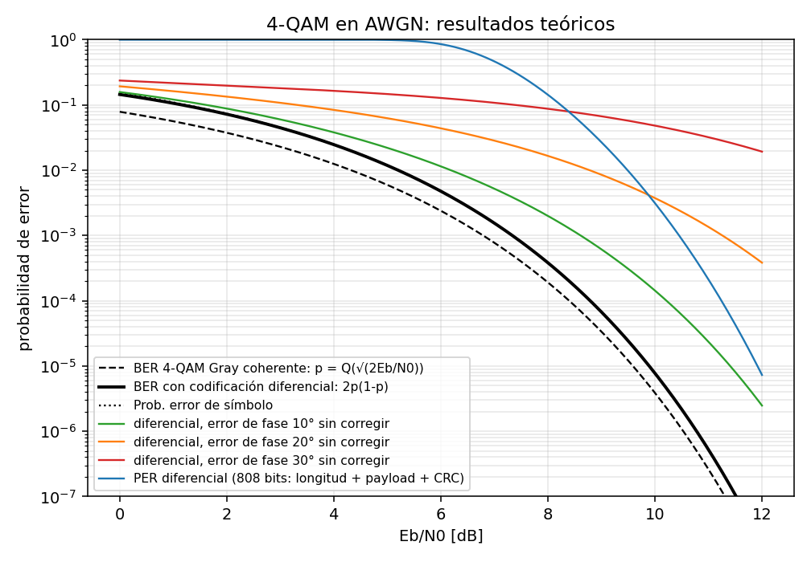

*Figura 1 – Curvas teóricas. La verificación Monte Carlo (`python ber_teorico.py --montecarlo`), que simula exactamente la
misma cadena que GNU Radio (mapa Gray → codificador diferencial → constelación → ruido → decisión → decodificador
diferencial), reproduce `2p(1−p)` y la versión con error de fase dentro del 1 %.*

### 2.4 Error de trama y detección con CRC-32

Como con codificación diferencial los errores vienen de a pares, una trama de `K` símbolos llega bien solo si no hay
ningún error de símbolo en ella ni en el símbolo anterior:

```
PER = 1 − (1 − Ps)^(K+1),      K = (32 bits de longitud + 8·(L + 4) bits de payload y CRC) / 2
```

Para el payload de `L = 93` bytes del sistema, `K = 404` símbolos. El CRC-32 detecta todos los errores de 1, 2 y 3 bits,
todas las ráfagas de hasta 32 bits y, para patrones de error aleatorios, deja pasar una fracción ≈ 2⁻³² ≈ 2,3×10⁻¹⁰;
por lo tanto el enlace *entrega* tramas con probabilidad `1 − PER` y *casi nunca* entrega tramas corruptas.

### 2.5 Error de fase constante sin corregir

Si el receptor no corrige una rotación fija `φ` de la portadora, cada eje tiene su propia probabilidad de error:

```
pa = Q( √(2Eb/N0)·(cos φ − sin φ) )        pb = Q( √(2Eb/N0)·(cos φ + sin φ) )
```

Sin codificación diferencial, `Pb(φ) = ½(pa + pb)`. Con codificación diferencial se combinan los giros de error de dos
decisiones seguidas igual que en 2.3 pero con `P(+90°) = pa(1−pb)`, `P(−90°) = pb(1−pa)`, `P(180°) = pa·pb`
(función `ber_deqpsk_phase_error` de `ber_teorico.py`). Para `φ = 20°`, `cos φ − sin φ = 0,60`: el margen de decisión de un
eje se reduce un 40 % y el BER se aleja mucho de la curva ideal (sección 6.2). Para `φ = 45°` el margen se anula.

---

## 3. Diseño del sistema

### 3.1 Arquitectura

```
 NODO A:  mensaje → CRC-32 → encabezado → modulador 4-QAM ──┐
                                                            ├──▶ Stream Mux: turnos [A | guarda | B | guarda]
 NODO B:  mensaje → CRC-32 → encabezado → modulador 4-QAM ──┘          │
                                                                       ▼
                                          CANAL COMPARTIDO: fase + ruido (Multiply Const, Noise Source, Add)
                                                                       │
                                                                       ▼
                                             Stream Demux: conmutador de recepción
                                            │                    │                    │
                               ranura de A  ▼           guardas  ▼        ranura de B ▼
                                 oscilador B (+Δf)           descarte         oscilador A (−Δf)
                                            │                                         │
                                            ▼                                         ▼
                               RECEPTOR B (recibe a A)                   RECEPTOR A (recibe a B)

 RECEPTOR:  filtro adaptado → Symbol Sync → Costas → decisión → decodificación diferencial → bits
            bits → detector de trama (preámbulo + longitud) → CRC-32 → mensajes
            bits → alineación con el primer preámbulo → comparación con una copia del transmisor → BER
```

Parámetros: frecuencia de muestreo `fs = 500 kHz`, `sps = 4` muestras/símbolo (velocidad de símbolo `Rs = 125 kbaudios`,
250 kbit/s), roll-off `α = 0,35` (ancho de banda ocupado `(1+α)·Rs = 169 kHz`, es decir ±84 kHz), filtros RRC de
11 símbolos. Cada nodo usa el canal en ranuras de 2048 muestras (4,1 ms) separadas por guardas de 256 muestras (0,5 ms).

### 3.2 Formato de trama y CRC-32

| Campo | Tamaño | Contenido | Bloque que lo genera |
|---|---|---|---|
| Preámbulo | 64 bits | Código de acceso estándar de GNU Radio (`digital.packet_utils.default_access_code`), elegido por su baja autocorrelación. Sirve para detectar la trama. | `Protocol Formatter` con `Header Format Default` |
| Longitud | 16 bits | Bytes de payload + CRC, en binario. | ídem |
| Longitud (copia) | 16 bits | La misma longitud repetida: el receptor solo acepta la trama si las dos copias coinciden. | ídem |
| Payload | `L` bytes | Un mensaje de texto (93 bytes en el half-duplex: *"Hola, soy el nodo A…"*). | `Vector Source` + `Stream to Tagged Stream` |
| CRC-32 | 32 bits | CRC-32 IEEE 802.3 del payload (el de Ethernet / `zlib`). | `Stream CRC32` |

La trama completa del half-duplex tiene 8 + 4 + 93 + 4 = 109 bytes = 872 bits = 436 símbolos. El `Tagged Stream Mux`
concatena encabezado y payload+CRC. Las tramas salen una detrás de otra (el mensaje se repite).

### 3.3 Modulación 4-QAM y conformación de pulso

* **Constelación** (`Constellation Rect.`): puntos `(±0,707 ± 0,707j)` con mapeo Gray `[0, 1, 3, 2]`.
* **`Constellation Modulator`**: agrupa los bits de a 2, aplica la codificación diferencial (sección 2.3) y el filtro de
  raíz de coseno realzado (RRC) de 11 símbolos con `α = 0,35`. Entrega 4 muestras por símbolo con **potencia media 1**
  (medido).
* **Filtro adaptado** (`FFT Root Raised Cosine Filter`, 44 coeficientes, ganancia 1) en el receptor: la cascada RRC·RRC es
  un filtro de Nyquist (sin interferencia entre símbolos en el instante óptimo) y los símbolos salen con amplitud 1.

### 3.4 Canal y calibración de Eb/N0

El canal se arma con bloques simples, para que la calibración quede explícita:

* `Multiply Const` por `e^{jφ}`: rotación de fase fija del canal (deslizador "Fase").
* `Noise Source` (gaussiano complejo) + `Add`: ruido blanco de varianza total `σ²` por muestra.
* `Rotator`: desvío de frecuencia (CFO) — ver 3.5.

Con potencia de señal `P = 1` por muestra, la energía por símbolo es `Es = P·sps` y `N0 = σ²`; por lo tanto

```
Es/N0 = 2·Eb/N0  ⟹  σ = √( sps / (2·Eb/N0) )          (variable `ruido` de los .grc)
```

**No se usa el bloque `Channel Model`**: se midió que su generador de ruido reutiliza solo **16 384 valores distintos**
(el mayor llega a 3,84 σ). A Eb/N0 = 10 dB un error de bit necesita ruido mayor que √(2·Eb/N0) ≈ 4,5 σ en un eje, de modo
que con ese bloque el BER daría **0** aunque la teoría diga 3,9×10⁻⁶. El `Noise Source` genera siempre valores nuevos.

### 3.5 Half-duplex por división en el tiempo (TDD)

* **Turnos (`Stream Mux`)**: el canal compartido se arma tomando, en forma cíclica, 2048 muestras del transmisor A,
  256 de silencio (guarda), 2048 del transmisor B y 256 de silencio. Mientras un nodo no tiene el turno, su transmisor
  queda en espera (no pierde datos: sigue donde quedó en su próximo turno). En las guardas no transmite nadie.
* **Conmutador de recepción (`Stream Demux`)**: con el mismo patrón de longitudes, las ranuras de A van al receptor de B,
  las de B al receptor de A y las guardas se descartan. **Ningún nodo escucha lo que él mismo transmite** y nunca
  transmiten los dos a la vez.
* Cada nodo usa el 44 % del tiempo del canal (≈ 111 kbit/s por sentido).
* **Desvío de frecuencia**: el CFO no es una propiedad del medio sino la **diferencia entre los osciladores** de los
  nodos; si el de A está `Δf` por encima del de B, el receptor de B ve `+Δf` y el de A ve `−Δf`. Por eso el `Rotator`
  se aplica a la entrada de cada receptor (B: `+Δf`, A: `−Δf`). Aplicarlo en el canal compartido sería incorrecto en esta
  simulación: el `Stream Demux` saca del flujo de cada receptor el tiempo de la ranura ajena, y el receptor vería un
  salto de fase en cada cambio de turno que un receptor real (cuyo oscilador sigue girando) no ve. Se comprobó: con el
  CFO en el canal compartido el BER subía a 1,5–2 veces la teoría con 100–500 Hz; con el modelo correcto queda ≈ teoría.

### 3.6 Receptor

Cada nodo tiene un receptor completo, todo con bloques estándar:

1. **Filtro adaptado** RRC (3.3).
2. **Sincronismo de símbolo** (`Symbol Sync`, detector de error de temporización de máxima verosimilitud, interpolador
   MMSE de 8 coeficientes, ancho de banda de lazo 0,01): elige el instante óptimo de muestreo y entrega 1 muestra por
   símbolo.
3. **Lazo de Costas** (`Costas Loop`, orden 4, ancho de banda 0,005): corrige la fase y la frecuencia de la portadora.
4. **Decisión** (`Constellation Decoder`) → **decodificación diferencial** (`Differential Decoder`, módulo 4) →
   **mapa Gray inverso** (`Map`) → **bits** (`Unpack K Bits`).
5. **Detección de trama** (`Correlate Access Code - Tag Stream`): busca el preámbulo tolerando hasta 12 bits erróneos
   de 64, lee las dos copias de la longitud (deben coincidir) y entrega solo el payload + CRC como "tagged stream".
6. **CRC-32** (`Repack Bits` → `Stream CRC32` en modo verificación): descarta las tramas con errores; las correctas se
   convierten en mensajes (`Tagged Stream to PDU`) y se escriben en `mensajes_recibidos_A.txt` / `_B.txt`
   (una de cada 100).

**Anchos de banda de los lazos.** Los valores típicos de los tutoriales de GNU Radio (Costas 0,0628 y sincronismo 0,045)
enganchan rápido pero agregan mucho ruido de fase y de temporización: con ellos el BER medido a 6 dB era 1,72 veces la
teoría. Con 0,005 y 0,01 baja a 1,06. Lazos todavía más angostos mejoran muy poco (1,24 → 1,16 a 10 dB) y enganchan
más lento; ambos anchos de banda quedan como controles en la interfaz.

### 3.7 Medición del BER

* Un segundo detector (`Correlate Access Code - Tag`) solo **marca** dónde termina el primer preámbulo y
  `Tagged Stream Align` descarta todo lo anterior: desde ahí el flujo de bits recibido está alineado con el transmitido.
* Se compara bit a bit con una **copia del transmisor del otro nodo** (los mismos bloques: como todas las tramas son
  iguales y van una tras otra, la alineación se mantiene aunque se pierdan tramas).
* El conteo lo hace el bloque estándar **`BER` (`fec.ber_bf`)**, que compara bytes empaquetados (8 bits por byte).
* Se descartan los primeros 100 000 bits (≈ 0,9 s de recepción por nodo, `Skip Head` en ambos flujos): mientras el lazo de
  Costas se engancha —por ejemplo a un CFO de 200 Hz, partiendo de 0 Hz— hay una ráfaga de errores de arranque
  (decenas de errores por nodo) que no pertenece al régimen permanente. Se comprobó que con 50 000 bits descartados el
  caso con CFO ya da los mismos errores que sin CFO; 100 000 deja margen.
* El BER medido incluye todos los bits después del primer preámbulo (encabezados, payload y CRC) de las tramas
  detectadas y no detectadas.

---

## 4. Implementación en GNU Radio

| Archivo | Para qué sirve |
|---|---|
| `grc_estandar/enlace_4qam_tramas.grc` | Enlace en un solo sentido con **un gráfico por etapa** (bits de la trama, señal transmitida, espectros, canal, ojo, sincronismo, constelaciones, frecuencia del lazo, histograma, bits recibidos vs transmitidos, BER). Sirve para entender qué pasa en cada bloque. |
| `grc_estandar/halfduplex_4qam.grc` | **Sistema completo**: dos nodos half-duplex por TDD, con interfaz (turnos en el canal, recepción de cada nodo y BER de cada uno). |
| `grc_estandar/halfduplex_4qam_ber.grc` | El mismo half-duplex **sin interfaz** y con parámetros por línea de comandos, para medir BER (lo usa `run_ber_sweep.py`). |

Controles de las interfaces: Eb/N0, fase del canal, CFO / desvío entre osciladores y anchos de banda de los dos lazos.
Arriba se muestran el BER teórico y el medido (acumulado y reciente).

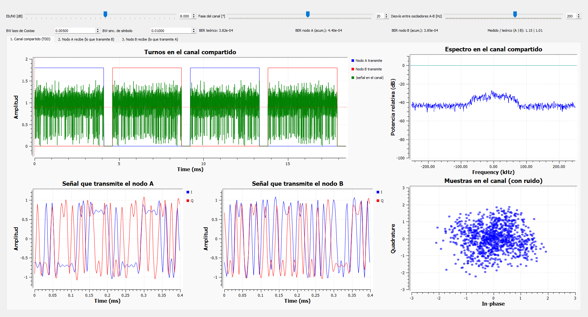

*Figura 2 – `halfduplex_4qam.grc`, pestaña 1 (Eb/N0 = 8 dB, fase 20°, desvío entre osciladores 200 Hz). Arriba a la
izquierda, los **turnos**: el nodo A (azul) y el nodo B (rojo) se alternan; la señal en el canal (verde) solo aparece en
el turno de cada uno y en las guardas el canal queda en silencio. Abajo, la señal de cada transmisor y las muestras en
el canal.*

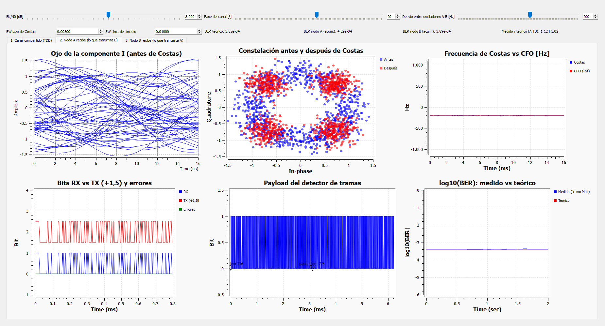

*Figura 3 – Pestaña 2: el nodo A recibe lo que transmite B. Antes de Costas la constelación es un anillo (gira por el
desvío de frecuencia y el ojo aparece cerrado); después del lazo quedan las cuatro nubes. El lazo estima −200 Hz, el
desvío que ve A. Abajo: bits recibidos vs transmitidos (sin errores en la ventana mostrada), payload entregado por el
detector de tramas (la etiqueta `len: 776` es payload + CRC en bits) y log₁₀(BER) medido vs teórico.*

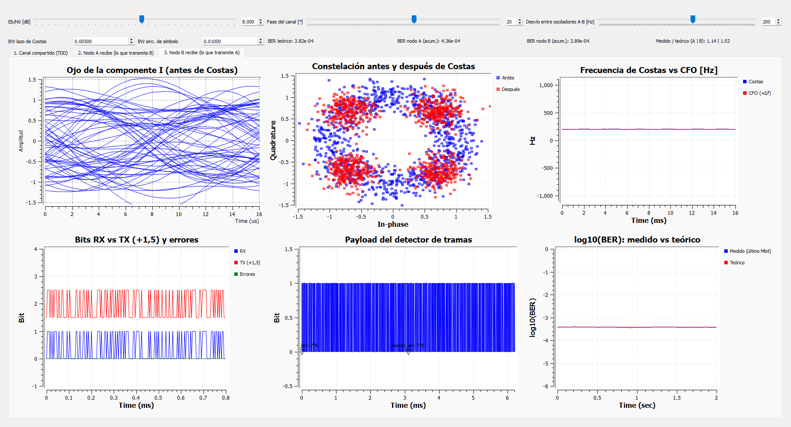

*Figura 4 – Pestaña 3: el nodo B recibe lo que transmite A; su lazo estima +200 Hz.*

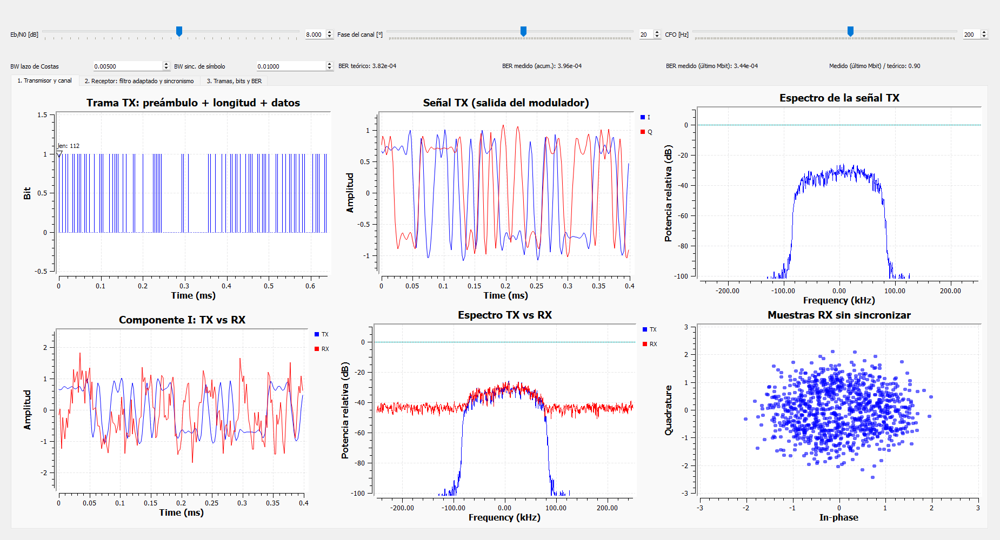

*Figura 5 – `enlace_4qam_tramas.grc`, pestaña 1: comienzo de una trama (preámbulo de 64 bits, longitud y comienzo del
payload; la etiqueta `packet_len: 112` marca el inicio de la trama de 112 bytes), señal transmitida (pulsos RRC en I y Q;
los tramos planos son símbolos repetidos: en el texto hay muchos bits en 0 y con codificación diferencial "00" significa
"repetir el símbolo anterior"), espectro (±84 kHz = (1+α)·Rs/2), señal transmitida vs recibida, espectros con ruido y
muestras recibidas sin sincronizar.*

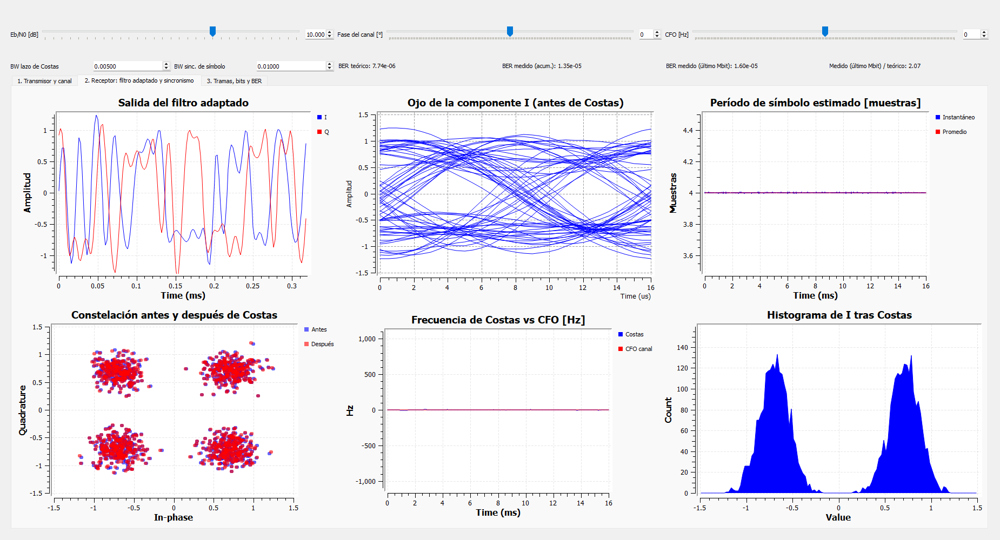

*Figura 6 – Pestaña 2 sin fase ni CFO (10 dB): **ojo abierto** en cada período de símbolo (8 µs), período de símbolo
estimado estable en 4 muestras, constelación con cuatro nubes (antes y después de Costas coinciden porque no hay nada que
corregir) e histograma de la componente I: dos campanas gaussianas centradas en ±0,707. Los números de BER de arriba
corresponden a pocos segundos de ejecución (pocos errores) y no son una medición; las mediciones están en la sección 6.*

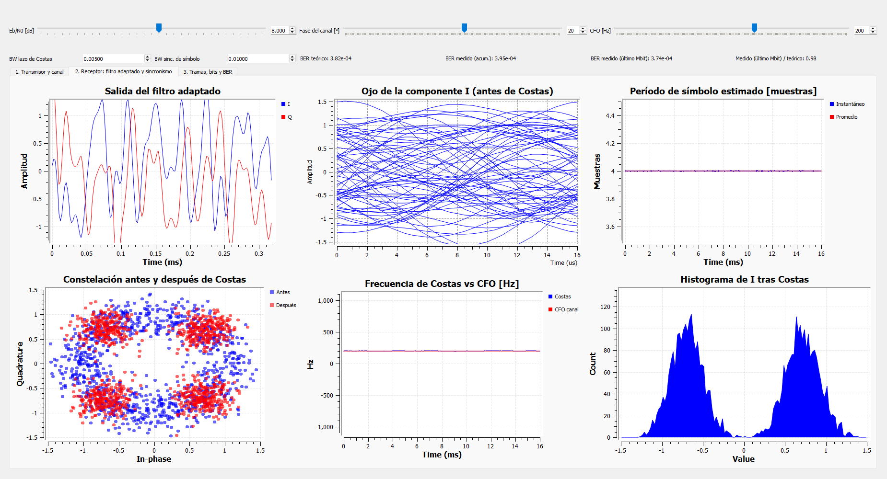

*Figura 7 – La misma pestaña con fase 20° y CFO 200 Hz: el ojo se cierra porque está antes del lazo de Costas (la rotación
mezcla I con Q), pero el lazo corrige la frecuencia (estima 200 Hz) y la constelación final vuelve a ser la de la Figura 6.*

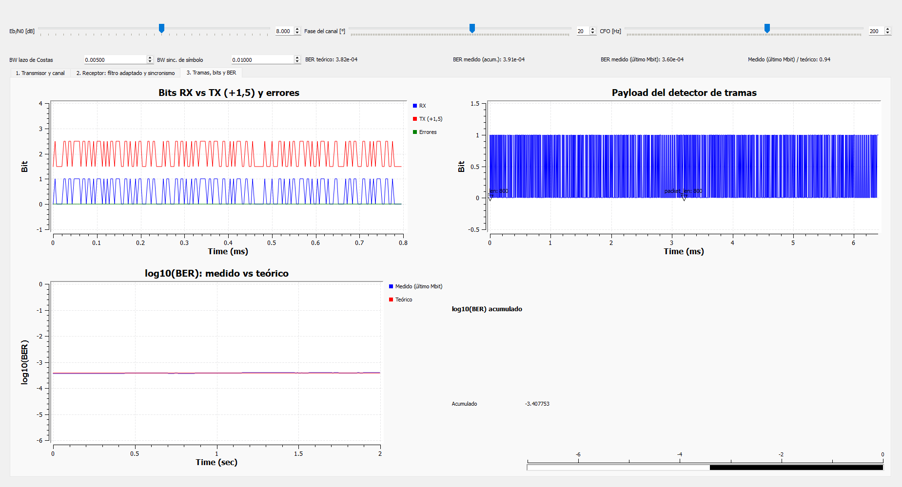

*Figura 8 – Pestaña 3: bits recibidos vs transmitidos con los errores (XOR), payload entregado por el detector de tramas,
log₁₀(BER) medido en el último millón de bits vs teórico y BER acumulado.*

---

## 5. Metodología de medición

* `python run_ber_sweep.py` compila `grc_estandar/halfduplex_4qam_ber.grc` con `grcc` y lo ejecuta una vez por punto
  (condición de canal, Eb/N0) con los parámetros correspondientes; el `.grc` es la única descripción del enlace.
* En cada punto corren **los dos nodos**; se suman los errores y los bits de los dos receptores.
* Muestras del canal por punto: las necesarias para acumular ≈ 400 errores (mínimo 4×10⁶ y máximo 2×10⁸ muestras).
* **BER** = errores / bits comparados (`fec.ber_bf`), con **intervalo de confianza de Wilson al 95 %**.
  **PER** = 1 − (tramas con CRC correcto) / (tramas enviadas); las tramas no detectadas cuentan como perdidas.
* Condiciones de canal: (1) AWGN ideal; (2) AWGN + fase de 20° **sin** corrección (lazo de Costas con ancho de banda 0);
  (3) AWGN + 20° **con** lazo de Costas; (4) AWGN + 20° + desvío entre osciladores de 200 Hz (0,16 % de la velocidad de
  símbolo) con lazo de Costas.
* Todas las condiciones usan la **misma semilla de ruido**, de modo que las diferencias entre ellas se deben al receptor y
  no al azar; con la misma semilla se obtienen exactamente los mismos números. El barrido completo (44 puntos,
  5,4×10⁸ muestras, 2,3×10⁸ bits comparados) tarda ≈ 30 segundos.

---

## 6. Resultados y análisis

### 6.1 AWGN ideal: BER medido vs teórico

| Eb/N0 [dB] | muestras | bits comparados | errores | BER medido | IC 95 % | BER teórico 2p(1−p) | medido / teórico | PER medido | PER teórico |
|---:|---:|---:|---:|---:|:---:|---:|---:|---:|---:|
| 0 | 4.000.000 | 1.576.600 | 235556 | 1,49×10⁻¹ | [1,49×10⁻¹ ; 1,50×10⁻¹] | 1,45×10⁻¹ | 1,031 | 1,000 | 1,000 |
| 1 | 4.000.000 | 1.576.600 | 172870 | 1,10×10⁻¹ | [1,09×10⁻¹ ; 1,10×10⁻¹] | 1,06×10⁻¹ | 1,032 | 1,000 | 1,000 |
| 2 | 4.000.000 | 1.577.472 | 118010 | 7,48×10⁻² | [7,44×10⁻² ; 7,52×10⁻²] | 7,22×10⁻² | 1,036 | 1,000 | 1,000 |
| 3 | 4.000.000 | 1.577.472 | 73760 | 4,68×10⁻² | [4,64×10⁻² ; 4,71×10⁻²] | 4,47×10⁻² | 1,046 | 1,000 | 1,000 |
| 4 | 4.000.000 | 1.577.472 | 40674 | 2,58×10⁻² | [2,55×10⁻² ; 2,60×10⁻²] | 2,47×10⁻² | 1,044 | 1,000 | 1,000 |
| 5 | 4.000.000 | 1.577.472 | 19506 | 1,24×10⁻² | [1,22×10⁻² ; 1,25×10⁻²] | 1,18×10⁻² | 1,045 | 0,994 | 0,992 |
| 6 | 4.000.000 | 1.577.472 | 7836 | 4,97×10⁻³ | [4,86×10⁻³ ; 5,08×10⁻³] | 4,77×10⁻³ | 1,042 | 0,864 | 0,856 |
| 7 | 4.000.000 | 1.577.472 | 2588 | 1,64×10⁻³ | [1,58×10⁻³ ; 1,70×10⁻³] | 1,54×10⁻³ | 1,062 | 0,493 | 0,465 |
| 8 | 4.000.000 | 1.577.472 | 584 | 3,70×10⁻⁴ | [3,41×10⁻⁴ ; 4,01×10⁻⁴] | 3,82×10⁻⁴ | 0,970 | 0,147 | 0,143 |
| 9 | 13.382.462 | 5.747.531 | 428 | 7,45×10⁻⁵ | [6,77×10⁻⁵ ; 8,19×10⁻⁵] | 6,73×10⁻⁵ | 1,107 | 0,030 | 0,027 |
| 10 | 116.216.210 | 51.451.402 | 508 | 9,87×10⁻⁶ | [9,05×10⁻⁶ ; 1,08×10⁻⁵] | 7,74×10⁻⁶ | 1,275 | 0,004 | 0,003 |

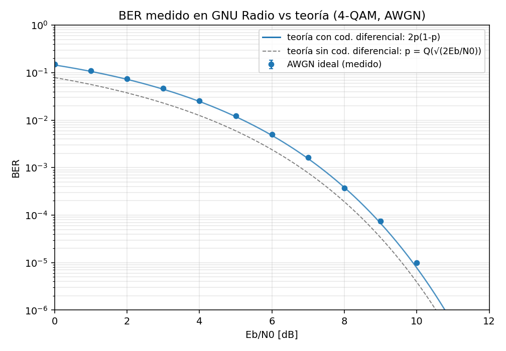

*Figura 9 – BER medido (puntos, con IC 95 %) vs teoría con codificación diferencial (línea azul). La línea gris es el
4-QAM coherente sin codificación diferencial: la distancia entre ambas es el costo de esa codificación (0,3 dB a 10⁻⁵).*

El BER medido sigue a `2p(1−p)` a lo largo de **más de cuatro décadas** (de 1,5×10⁻¹ a 1×10⁻⁵). Entre 0 y 7 dB el exceso es
de 3–6 % y es sistemático: con miles o decenas de miles de errores por punto el IC 95 % es de solo ± 1–4 % y la teoría queda
justo fuera de él. Ese exceso equivale a **+0,08 dB** de Eb/N0 (tabla 6.6) y es la **pérdida de implementación** de un
receptor real: el lazo de Costas y el sincronismo de símbolo estiman la fase y el instante de muestreo a partir de la
señal ruidosa, y esas estimaciones tienen su propio ruido. A 8 dB la teoría cae dentro del intervalo; a 9 y 10 dB el
cociente sube a 1,11 y 1,27 (≈ 0,1 dB): a Eb/N0 alto la curva es tan empinada que el mismo pequeño corrimiento en dB se
traduce en un cociente mayor.

### 6.2 Rotación de fase fija sin corregir

| Eb/N0 [dB] | errores | BER medido | BER teórico (2.5) | medido / teórico | nodo A | nodo B |
|---:|---:|---:|---:|---:|---:|---:|
| 0 | 306360 | 1,94×10⁻¹ | 1,93×10⁻¹ | 1,007 | 1,94×10⁻¹ | 1,95×10⁻¹ |
| 1 | 258110 | 1,64×10⁻¹ | 1,63×10⁻¹ | 1,007 | 1,64×10⁻¹ | 1,64×10⁻¹ |
| 2 | 212560 | 1,35×10⁻¹ | 1,34×10⁻¹ | 1,005 | 1,35×10⁻¹ | 1,35×10⁻¹ |
| 3 | 171478 | 1,09×10⁻¹ | 1,08×10⁻¹ | 1,007 | 1,09×10⁻¹ | 1,09×10⁻¹ |
| 4 | 132982 | 8,43×10⁻² | 8,41×10⁻² | 1,003 | 8,42×10⁻² | 8,44×10⁻² |
| 5 | 99198 | 6,29×10⁻² | 6,26×10⁻² | 1,004 | 6,29×10⁻² | 6,29×10⁻² |
| 6 | 69626 | 4,41×10⁻² | 4,39×10⁻² | 1,005 | 4,41×10⁻² | 4,41×10⁻² |
| 7 | 45456 | 2,88×10⁻² | 2,84×10⁻² | 1,015 | 2,90×10⁻² | 2,87×10⁻² |
| 8 | 26536 | 1,68×10⁻² | 1,66×10⁻² | 1,014 | 1,69×10⁻² | 1,67×10⁻² |
| 9 | 13470 | 8,54×10⁻³ | 8,53×10⁻³ | 1,001 | 8,60×10⁻³ | 8,48×10⁻³ |
| 10 | 5868 | 3,72×10⁻³ | 3,75×10⁻³ | 0,993 | 3,77×10⁻³ | 3,67×10⁻³ |

Sin corregir la fase (`φ = 20°`, lazo de Costas con ancho de banda 0) el BER **no** sigue la curva ideal: a 10 dB es
3,72×10⁻³ contra 7,74×10⁻⁶ ideal, casi tres décadas peor. Pero coincide con la fórmula de la sección 2.5 con una exactitud
notable (cociente medio 1,006): en este caso no hay ningún lazo de fase y la única fuente de pérdida de implementación es
el sincronismo de símbolo. Esto valida a la vez el modelo teórico y la simulación.

### 6.3 Rotación de fase con lazo de Costas

| Eb/N0 [dB] | errores | BER medido | BER teórico | medido / teórico | nodo A | nodo B |
|---:|---:|---:|---:|---:|---:|---:|
| 0 | 235938 | 1,50×10⁻¹ | 1,45×10⁻¹ | 1,033 | 1,50×10⁻¹ | 1,50×10⁻¹ |
| 1 | 173522 | 1,10×10⁻¹ | 1,06×10⁻¹ | 1,037 | 1,10×10⁻¹ | 1,10×10⁻¹ |
| 2 | 117980 | 7,48×10⁻² | 7,22×10⁻² | 1,036 | 7,50×10⁻² | 7,47×10⁻² |
| 3 | 73698 | 4,67×10⁻² | 4,47×10⁻² | 1,045 | 4,70×10⁻² | 4,64×10⁻² |
| 4 | 40658 | 2,58×10⁻² | 2,47×10⁻² | 1,044 | 2,59×10⁻² | 2,56×10⁻² |
| 5 | 19602 | 1,24×10⁻² | 1,18×10⁻² | 1,050 | 1,26×10⁻² | 1,22×10⁻² |
| 6 | 7776 | 4,93×10⁻³ | 4,77×10⁻³ | 1,034 | 4,92×10⁻³ | 4,94×10⁻³ |
| 7 | 2510 | 1,59×10⁻³ | 1,54×10⁻³ | 1,030 | 1,61×10⁻³ | 1,57×10⁻³ |
| 8 | 620 | 3,93×10⁻⁴ | 3,82×10⁻⁴ | 1,030 | 4,21×10⁻⁴ | 3,65×10⁻⁴ |
| 9 | 428 | 7,45×10⁻⁵ | 6,73×10⁻⁵ | 1,107 | 6,75×10⁻⁵ | 8,14×10⁻⁵ |
| 10 | 488 | 9,48×10⁻⁶ | 7,74×10⁻⁶ | 1,225 | 1,00×10⁻⁵ | 8,94×10⁻⁶ |

Con el lazo de Costas la misma rotación queda compensada y el receptor recupera la curva AWGN (pérdida equivalente
+0,08 dB, igual que sin rotación). Como la semilla de ruido es la misma, los errores son prácticamente los mismos que en 6.1
(a 9 dB, exactamente 428 en ambos casos): la rotación no deja rastro una vez corregida.

### 6.4 Rotación de fase + desvío de frecuencia con lazo de Costas

| Eb/N0 [dB] | errores | BER medido | BER teórico | medido / teórico | nodo A | nodo B |
|---:|---:|---:|---:|---:|---:|---:|
| 0 | 235776 | 1,50×10⁻¹ | 1,45×10⁻¹ | 1,033 | 1,50×10⁻¹ | 1,50×10⁻¹ |
| 1 | 173446 | 1,10×10⁻¹ | 1,06×10⁻¹ | 1,037 | 1,10×10⁻¹ | 1,10×10⁻¹ |
| 2 | 118096 | 7,49×10⁻² | 7,22×10⁻² | 1,037 | 7,50×10⁻² | 7,48×10⁻² |
| 3 | 73624 | 4,67×10⁻² | 4,47×10⁻² | 1,044 | 4,70×10⁻² | 4,64×10⁻² |
| 4 | 40670 | 2,58×10⁻² | 2,47×10⁻² | 1,045 | 2,59×10⁻² | 2,57×10⁻² |
| 5 | 19548 | 1,24×10⁻² | 1,18×10⁻² | 1,047 | 1,26×10⁻² | 1,22×10⁻² |
| 6 | 7776 | 4,93×10⁻³ | 4,77×10⁻³ | 1,035 | 4,91×10⁻³ | 4,95×10⁻³ |
| 7 | 2506 | 1,59×10⁻³ | 1,54×10⁻³ | 1,029 | 1,61×10⁻³ | 1,57×10⁻³ |
| 8 | 616 | 3,90×10⁻⁴ | 3,82×10⁻⁴ | 1,023 | 4,13×10⁻⁴ | 3,68×10⁻⁴ |
| 9 | 432 | 7,52×10⁻⁵ | 6,73×10⁻⁵ | 1,118 | 6,75×10⁻⁵ | 8,28×10⁻⁵ |
| 10 | 490 | 9,52×10⁻⁶ | 7,74×10⁻⁶ | 1,230 | 9,95×10⁻⁶ | 9,10×10⁻⁶ |

Con un desvío de 200 Hz la fase gira 0,01 rad por símbolo, ≈ 4,4 rad (250°) a lo largo de una trama: sin seguimiento de
frecuencia la trama sería irrecuperable. El lazo de Costas de segundo orden estima la frecuencia (Figuras 3 y 7) y,
descontado el enganche inicial (3.7), el BER es **el mismo** que sin desvío (pérdida +0,08 dB). La codificación
diferencial hace que el enganche del lazo en cualquiera de las cuatro rotaciones posibles no importe.

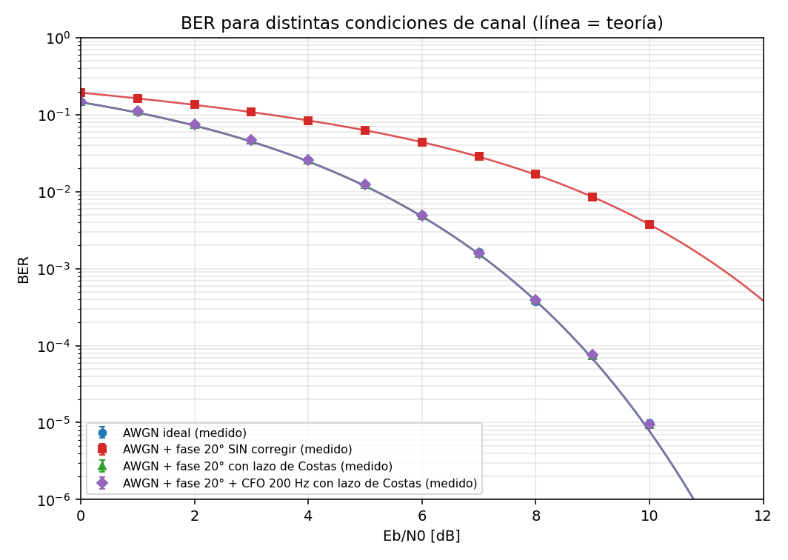

*Figura 10 – BER para las cuatro condiciones de canal (puntos = medido, línea = teoría correspondiente). Las tres
condiciones con el lazo de Costas se superponen con la curva AWGN.*

### 6.5 Detección de errores (CRC-32) y tasa de error de trama

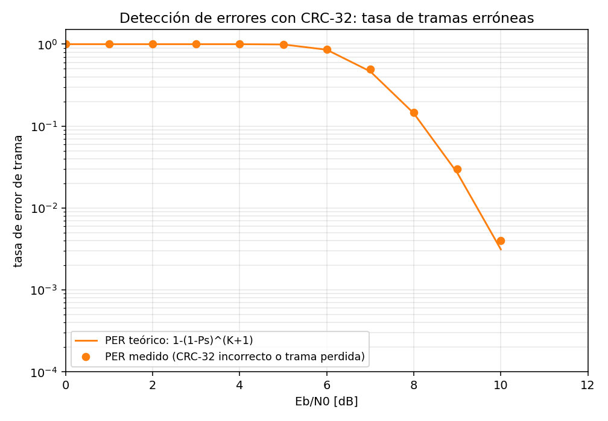

*Figura 11 – PER medido vs `1 − (1 − Ps)^(K+1)` (sección 2.4).*

* El PER medido coincide con la teoría en todo el rango (columnas "PER" de la tabla 6.1; por ejemplo 0,147 vs 0,143 a
  8 dB y 0,030 vs 0,027 a 9 dB). El pequeño exceso viene de la pérdida de implementación (el BER medido es 3–6 % mayor
  que el teórico) y de las tramas cuyo preámbulo no se detecta.
* En todo el barrido se enviaron **275.647 tramas** y el receptor aceptó **206.473** con CRC correcto; se comparó cada una
  con el mensaje transmitido y **en ninguna** el contenido difería (0 errores no detectados), coherente con una
  probabilidad ≈ 2⁻³² por trama corrupta.

### 6.6 Resumen de pérdidas respecto de la teoría

Pérdida equivalente = Eb/N0 adicional que necesitaría la curva teórica para dar el BER medido (promedio ponderado por
errores, solo puntos con ≥ 100 errores), separada en Eb/N0 bajo (0–1 dB) y medio-alto (2–10 dB). Para la condición
«fase sin corregir» la referencia es su propia curva teórica (sección 2.5):

| Condición de canal | pérdida a 0–1 dB [dB] | pérdida a 2–10 dB [dB] | medido/teórico medio (2–10 dB) | puntos (2–10 dB) |
|---|---:|---:|---:|---:|
| AWGN ideal | +0,10 | +0,08 | 1,042 | 9 |
| AWGN + fase 20° SIN corregir | +0,04 | +0,02 | 1,006 | 9 |
| AWGN + fase 20° con lazo de Costas | +0,11 | +0,08 | 1,041 | 9 |
| AWGN + fase 20° + CFO 200 Hz con lazo de Costas | +0,11 | +0,08 | 1,042 | 9 |

**Conclusión:** el enlace half-duplex armado solo con bloques estándar de GNU Radio alcanza el BER teórico del 4-QAM con
codificación diferencial con una pérdida de implementación menor a 0,1 dB, también con rotación de fase y desvío de
frecuencia, y entrega los mensajes sin errores no detectados.

---

## 7. Problemas encontrados y cómo se resolvieron

El sistema partió de dos flowgraphs previos (un medidor de BER y un transceptor de paquetes) que no funcionaban. Estos
fueron los problemas, en el orden en que aparecieron; todos se resolvieron con bloques o parámetros estándar:

| Problema | Causa | Solución |
|---|---|---|
| El BER no se podía medir a Eb/N0 alto | `Channel Model` reutiliza 16 384 valores de ruido (máximo 3,84 σ) | Canal con `Noise Source` + `Add` (3.4) |
| BER medido 8 veces menor que el real | `fec.ber_bf` espera bytes empaquetados y recibía bits sueltos | `Repack Bits` (1 → 8) antes del medidor |
| El receptor de tramas no entregaba nada | Después de `Correlate Access Code - Tag Stream` (que ya quita la cabecera) había un `Header/Payload Demux` que esperaba otro formato; además, la etiqueta se llamaba distinto | Ir directo a `Repack Bits` → `Stream CRC32` con la misma etiqueta |
| BER 1,7 veces la teoría | Lazos de Costas y sincronismo demasiado anchos | Anchos de banda 0,005 y 0,01 (3.6) |
| Sin codificación diferencial se perdían tramas | Ambigüedad de 90° del lazo de Costas | Codificación diferencial; teoría `2p(1−p)` (2.3) |
| El flowgraph se colgaba a Eb/N0 bajo | Si el ruido corrompe igual las dos copias de la longitud, el detector acepta una "trama" de cientos de miles de bits que no entra en el buffer del bloque siguiente | `Min Output Buffer` = 600 000 en el detector y 70 000 en `Repack Bits` y `Stream CRC32` (pestaña *Advanced*) |
| El BER saltaba a 0,5 | Medir comparando tramas: una longitud corrupta desalinea la referencia | Alinear con el primer preámbulo (`Correlate Access Code - Tag` + `Tagged Stream Align`) y comparar flujos continuos (3.7) |
| Con CFO, BER 1,5–2 veces la teoría en el half-duplex | El CFO aplicado al canal compartido produce saltos de fase en cada cambio de turno | CFO como diferencia entre osciladores, aplicado en cada receptor (3.5) |
| El half-duplex con interfaz se trababa a los pocos segundos | Una misma fuente alimentaba entradas de un `Stream Mux` que consumen a ritmos distintos | Patrón de turnos con `Vector Source` y una fuente por entrada |
| BER 2–3 veces la teoría a Eb/N0 alto con CFO (corridas cortas) | Ráfaga de errores mientras el lazo de Costas se engancha | Descartar los primeros 100 000 bits en la medición (3.7) |

---

## 8. Verificación del software

`python tests/test_flowgraphs.py` (9 pruebas, ≈ 30 s, con GNU Radio real) comprueba que: los tres `.grc` compilan con
`grcc`; el BER medido coincide con la teoría en AWGN, con fase sin corregir y con fase + CFO; cada nodo recibe exactamente
el mensaje del otro con CRC correcto; con la misma semilla se obtiene el mismo resultado; los dos flowgraphs con interfaz
corren varios segundos sin trabarse y con BER cercano a la teoría (habría detectado el problema del `Stream Mux`); y la
teoría con codificación diferencial coincide con su verificación Monte Carlo.

---

## 9. Limitaciones y posibles extensiones

* Los resultados cubren AWGN con errores de fase/frecuencia fijos; no se modeló desvanecimiento, multitrayecto ni deriva
  del reloj de muestreo (el `Stream Demux` supone que los dos nodos comparten el reloj de ranuras; con deriva habría que
  sincronizar las ranuras con el preámbulo).
* El lazo de Costas tarda en engancharse con CFO grandes (≳ 500 Hz con ancho de banda 0,005); para osciladores reales
  (decenas de ppm en RF) haría falta un estimador grueso de frecuencia previo o un lazo más ancho durante el enganche.
* La codificación diferencial cuesta ≈ 0,3 dB a BER 10⁻⁵. Se podría evitar resolviendo la ambigüedad de fase con el
  preámbulo (`Correlation Estimator`), a costa de un receptor más complejo.
* El encabezado estándar protege la longitud solo con la repetición; un encabezado con CRC propio reduciría las tramas
  perdidas a Eb/N0 bajo.
* Extensiones: reconocimiento y retransmisión (ARQ) sobre los mismos turnos, codificación de canal (FEC), y reemplazo del
  canal simulado por un SDR real (por ejemplo un HackRF, que es half-duplex por naturaleza).

---

## 10. Referencias

* J. G. Proakis, M. Salehi, *Digital Communications*, 5.ª ed., McGraw-Hill — BER de PSK/QAM en AWGN, codificación
  diferencial, error de fase.
* B. Sklar, *Digital Communications: Fundamentals and Applications*, Prentice Hall.
* P. Koopman, T. Chakravarty, "Cyclic Redundancy Code (CRC) Polynomial Selection for Embedded Networks", DSN 2004.
* Documentación de GNU Radio (`wiki.gnuradio.org`): *Guided Tutorial PSK Demodulation*, bloques *Constellation Modulator*,
  *Symbol Sync*, *Costas Loop*, *Correlate Access Code*, *Stream Mux/Demux*, *BER*.
